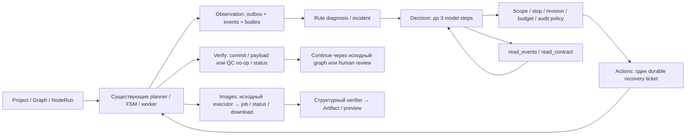

# Оркестратор: фактическое состояние на 30.09.2026

## Зафиксированная версия и метод

- **HEAD:** `01583e55f87c171824c99e553cbc901830929325`.
- **Ветка:** `feature/orchestrator-observe-v1`, существующий `work/video-pipeline-observe-v1`.
- **Фактическая база:** `41c88d257add318af849edd2ccc04483677e7361` — текущая локальная ссылка `origin/housepc` и merge-base с HEAD. Новый fetch не выполнялся. Первоначальный `c63d0a53` относится к более ранней подготовке, а не к фактическому основанию этой feature-ветки.
- **До отчёта:** `git status --porcelain` пуст. После отчёта добавлены только два запрошенных документа; HEAD не изменён, новый checkpoint ради отчёта не создан.
- После базы **134 локальных commit**; diff базы→HEAD: **164 файла, +17 357 / −98 строк**. Полные списки — приложения A/B и [машиночитаемый отчёт](ORCHESTRATOR_CURRENT_STATE.json).
- Проведено только чтение кода, Git, сохранённых сводок, SQLite ledger и сверка SHA-256. Приложение, тесты, браузер и реальные API **не запускались**. Ключи и `.env` не читались. Обнаруженные ограничения не исправлялись.

Обозначение `outputs/...` ниже — каталог материалов **в корне общего стенда, вне клона**; из этого документа ему соответствует `../../../outputs/`. `app/...`, `scripts/...`, `tests/...`, `web/...`, `config/...` относятся к текущему клону. Ссылки указывают на доказательства, а не заменяют их оценку. Сырые тела, персональные абсолютные пути и рабочие данные заказчика сюда не перенесены.

### Что существует вне Git

`outputs/` хранит результаты, очищенные полные тела, SSE, журналы, отдельные master/project БД, gateway ledger, снимки источников, loaded-module hashes, HTML/PNG и скриншоты. Найдено **347 run-config**, **663 записей сверки manifest/loaded files**, 33 отчёта вне копий исходников, 68 файлов gateway/ledger, включая синтетические копии. Это инвентаризация, **не число успешных тестов или реальных запусков**. Полный безопасный индекс находится в `evidence_inventory` JSON.

Историческая обёртка `work/diag_v2/`: `config.json`, `instrument.py`, `instrument_context.py`, `store.py`, `transport.py`, `free_runner.py`, `group_runner.py`, `online_runner.py`, `gateway.py`, `run_free.ps1`, `run_group.ps1`; там же старые проверочные и Docker/Hyper-V диагностические скрипты. Она меняла условия диагностики за пределами исходного клона, даже когда его diff был пуст. Имена файлов и SHA-256 указанных wrapper/config сохранены в `outside_git` JSON. Текущий gateway уже версионирован в `scripts/diagnostics/`, fixture-функции — в `tests/observe_v1/group_runner.py`; это не означает, что старые запуски использовали нынешние файлы.

Также вне Git остаются `work/local-data/`, `work/tmp/`, `work/venv*`, `work/uv-*`, резервная копия Docker и старый диагностический клон. Их наличие не считается готовой production-инсталляцией. При этой работе они не исполнялись и не изменялись.

### Процессы на момент осмотра

Docker Desktop/backend работают. Активных `vp-observe-test-*` и диагностических gateway-контейнеров не обнаружено. Работают семь чужих `supabase_*_premium-lms-local`: db, pg_meta, storage, rest, inbucket, auth, kong. Они не останавливались. На хосте есть Node/Python-процессы; принадлежность текущему стенду по одним именам не доказана. PID и имена релевантных host-процессов сохранены в `process_snapshot.host_relevant_processes` JSON; команды и аргументы не копировались. Поэтому утверждения «все процессы на компьютере остановлены» нет. Последний собственный worker-контейнер завершился exit 0, OOM=false; его материалы сохранены.

## 1. Что уже было в housepc

| Механизм базы | Где находится | Что использовано, а не создано заново |
|---|---|---|
| Worker и исполнители | `app/main.py`, `app/worker.py`, `app/services/pipeline_worker.py`, `app/orchestrator/pipeline.py`, `app/orchestrator/steps/` | Рабочий цикл, выбор активных проектов, исполнение шагов, обработка ошибок. Нового второго worker нет. |
| Planner, граф и автоматические переходы | `app/orchestrator/graph/planner.py`, `auto_advance.py`, `node_registry.py`, `app/services/advance_runner.py` | Выбор готовой ноды, prerequisite, ветви verdict/HITL, последовательное продолжение. Новое управление дополняет точки разрешения. |
| Состояния, очередь, БД | `app/models.py`, `node_status_machine.py`, `gen_queue.py`, `gen_queue_run.py`, `app/project_db.py` | WorkflowRun/NodeRun, FSM, queue/lock/stop, master и отдельная БД проекта. Они не заменены новой моделью workflow. |
| Штатные повторы | `step_failure_policy.py`, `gpt_api.py`, `gpt_operator_client.py`, `apply_ops_batches.py` | Транспортный retry, continuation/разбиение, JSON retry, счётчик 3×3 failures, backoff и остановка после 9. Обычная пауза 30 минут; для ряда ошибок apply-ops/формата — 2 минуты. |
| Проверки и применение | `db_apply.py`, `post_step_validate.py`, `agent_harness.py`, исходные проверки apply-ops/coverage/verdict | Проверка структуры и данных, применение в project DB, транзакции, HTML. Не новый генератор отчётов в тестовом сервере. |
| Модели, промпты, агенты | `llm_override.py`, `text_llm_catalog.py`, `vibecode_catalog.py`, `prompt_library.py`, `scene_design/agents.py` | Каталоги, выбор модели для ноды, готовые агенты/провайдеры. Наличие каталога не даёт новому supervisor право выбирать любую модель. |
| Старый orchestrator/chat, Fix bugs, meta-agent | `app/web/routers/db_browser.py:orchestrator_chat`, `meta_agent.py` | Ручной диалог, контекст проекта, предложение/apply ops и генерация промптов уже существовали. Это не нынешний durable supervisor. Для managed execution старый chat/Fix bugs теперь отклоняется с 409. |
| API и группы | `app/web/routers/projects.py`, проектный `project_steps`, `templates/node_groups/script_frames_qc/` | Оригинальный запуск и группа сценарий→проверка→действие→кадры→QC→HTML. |

Исторические реальные события показывают границу исходной автоматизации: в `online-real-20260924-04` QC сам сделал второй JSON POST и продолжил pipeline. Это заранее запрограммированное восстановление, а не самостоятельный выбор стратегии. Позже доказано противоречие QC-контракта; подробнее §2.7.

## 2. Что добавлено

### 2.1 Observe

**Код:** `app/services/observation.py`, `observation_files.py`; router `app/web/routers/observations.py`; интеграция startup в `app/main.py`, миграция существующей project DB в `app/project_db.py`.

**Таблицы:** `observation_executions`, `observation_outbox`, `observation_events`. Outbox записывается с бизнес-транзакцией; внешний факт ответа модели записывается отдельно и не исчезает из истории из-за последующего rollback проекта. Корреляция: execution/project/workflow/node/attempt/request, область master/project, cursor и event ID.

Сохраняются старт/окончание ноды, смены NodeRun, модельный запрос и результат, SSE/завершённость, parse/payload, apply/check, решения/отказы перехода, wait/stop, ошибки и операторские controls. Контекст объединяет реплики master/project, текущие attempts, checks и ожидания. Это **не тотальная трассировка всех SQL и каждого lock во всех старых ветвях**. Исходная отдельная диагностическая обёртка имела более подробные SQL commit begin/end; её охват нельзя автоматически приписать runtime Observe.

События, cursor, scopes и принятые тела переживают reload/restart; незавершённость и gap отмечаются явно. Лимиты тела 1 MiB, общего хранилища 32 MiB; превышение не маскируется обрезанным «полным» ответом. Для managed действия отсутствие обязательного audit блокирует дальнейшее выполнение. Сохранение ещё не записанного хвоста при падении не обещается.

**API:** `/api/projects/{project_id}/observations`: enable/list, `/{execution}/stop`, `/pin`, `/events`, `/context`, `/diagnoses`. UI — блок «Наблюдение». Его остановка прекращает наблюдение, **не останавливает pipeline**. Managed-контроль выдаётся отдельно.

Общий additive `migrate_observation_schema` создаёт **15 таблиц** Observe/Diagnose/Actions/Decision/Profiles/Media через `Base.metadata.create_all` в штатном startup; отдельного нового движка миграций нет. Создание outbox для уже существующих наблюдаемых project DB было исправлено и проверено.

### 2.2 Diagnose

**Код:** `app/services/diagnosis.py`; таблицы `observation_diagnosis`, `observation_incidents`; UI `diagnosis-section.tsx`.

Реально классифицируются `invalid_json`, `missing_payload`, `contract_rejected`, `api_error`, `uncertain_request`, `runtime_wait`, `user_stop`, `db_disagreement`, `journal_gap`, `media_failure`, `media_policy`. Правила различают синтаксис JSON, требование непустого результата и разрешённый QC no-op. Известный незавершённый job не объявляется автоматически зависшим.

Связь строится по node/attempt/request, цепочке `previous_request_id`; старое слабое сопоставление допускается только при однозначности. Другая поздняя попытка может сделать прежний incident неактуальным; это **не** переписывает его как resolved. `resolved_confirmed` требует связанных фактов успешного ответа/parse, транзакционного применения и done, либо доказанного допустимого QC no-op и done. DB disagreement не закрывается успехом другой проверки.

Классификатор детерминированный. Причина часто остаётся `hypothesis=null`, `certainty=unknown`. Сообщение API или предположение LLM не превращается в доказанный root cause. Расхождение снимков БД может быть предупреждением для человека, а не доказанной порчей или блокирующим runtime-событием. Вся эта градация видна в details/recommendation и UI.

### 2.3 Actions

**Код:** `actions_v1.py`, `actions_recovery.py`, guards в `node_status_machine.py`, `advance_runner.py`, `auto_advance.py`; таблицы `action_execution_controls`, `action_v1_records`, `action_node_recoveries`.

Доступны разрешение execution/scope, запуск следующей допустимой ноды штатным FSM, hold/resume управления, одна recovery конкретной ноды, verify, human review, close execution. API: `/actions/enable`, `/control`, `/start`, `/retry`, `/verify`, `/review`, `/close`. Все изменяющие действия требуют явного разрешения, rationale и сохранённых идентификаторов; ordinary mode не переводится в managed сам.

Recovery разрешена для актуального invalid JSON/обязательного payload после исчерпания native retry: предыдущая попытка завершена; нет неподтверждённого применения, активного/uncertain запроса, user_stop/HITL/audit blocker; совпадают вход, граф и конфигурация; есть бюджет. Сохраняются source/new attempt, incident/node/execution, idempotency key, preconditions, budget/result/verification. Уникальность ticket ограничивает **одну дополнительную попытку на node/execution**, не обнуляет старые attempts и не создаёт второй worker. Scoped-пилот дополнительно связан с одним incident/source attempt и `recovery_limit=1`.

Общий атомарный `requests_used` резервируется до HTTP; учитывает Decision, worker, разрешённые retrieval/continuation и media submit/status/download. Перезапуск не возвращает расход. Для media есть отдельные строки `orchestrator_media_requests`; gateway имеет независимый ledger. Это **предел операций, не подтверждённый денежный cap**.

Hold запрещает новые действия/запросы и не гарантирует отмену принятого провайдером запроса. Supervisor не снимает `user_stop`. Close отказывает при активных нодах/recovery/media; отзывает разрешение, но не ставит всему WorkflowRun done. Старый ручной `run_step`, который снимает backoff, для recovery не используется; legacy chat/Fix bugs и ручной start managed-проекта не обходят policy.

Verify сопоставляет новый attempt, ответ/parse/check, commit/apply либо разрешённый no-op и реальный NodeRun done. Продолжение идёт после verify. Последний фикс `d38a9a8a` сохраняет исходный `runtime_config_hash` в recovery result и восстанавливает его в reconcile. Старые tickets без доказанного hash остаются заблокированными. `continuation_submitted` означает вызов continuation; фактический старт подтверждается отдельно событием/NodeRun.

### 2.4 Decision

**Код:** `decision_v1.py`, `decision_state.py`, `decision_config.py`, `decision_transport.py`; таблицы `decision_execution_controls`, `decision_records`, `decision_turns`, `decision_runtime_bindings`.

Настоящий `Observer.loop` вызывает diagnose/reconcile/Decision tick. Автоматический вход Decision сейчас ограничен **исчерпанными актуальными текстовыми `invalid_json`/`missing_payload`**, а не любой ошибкой любой ноды. Контекст включает scope/incident/status/attempt/revisions, allowed actions, budget, capability, evidence IDs и первые 20 фактов попытки; дополнительные факты читаются инструментом. Полный произвольный проект/репозиторий модели не предоставляется.

Основные действия: `read_events`, `read_contract`, `wait`, `human_review`; при разрешении текста — `retry_same`, одобренный `retry_profile`, `finish`. Фильтр одновременно учитывает configuration, capability и текущее состояние. `finish` не является командой сделать ноду успешной: нужен подтверждённый worker verification. У модели нет shell, SQL, file editor, произвольного endpoint, увеличения бюджета или изменения scope/gates.

**Максимум 3 model steps на DecisionRecord**, включая исправление схемы ответа; дополнительно действует общий HTTP budget. Leases/CAS защищают исполнение. Незавершённый model_pending/acting после истечения lease становится uncertain/human review либо связывается с уже созданным durable ticket, а не отправляется повторно. Schema repair может занять оставшийся разрешённый step; это не бесконечный цикл.

Сохраняются context/version, proposal/evidence/policy, model steps, assistant/tool turns, HTTP events, ссылки на тела и результат worker. Следующий вызов получает реальные сохранённые tool-result в history (`tool` сериализован как сообщение с `tool_result`), а не фикстуру, добавленную runner. В общем runtime `wait` возвращает запись в `ready`; отдельный пилот прекращает цикл при wait. Долговременного универсального планировщика ожиданий эта команда не создаёт.

Реальный read-only цикл действительно принял два ответа: `read_contract` → `human_review`. Контекст уже содержал классифицированный synthetic incident. Это доказательство передачи результата инструмента и безопасного решения **на одном примере**, не доказательство независимого root-cause reasoning или реального автономного recovery. Runtime после этого изменялся; текущая версия проверена бесплатно, не новым online запуском.

### 2.5 Profiles

**Код:** `profiles_v1.py`, `profiles_state.py`, `prompt_library.py`; таблица `node_profile_overlays`; API `/profiles`, `/profiles/approve`, `/profiles/{overlay}/cancel`.

Реальный overlay меняет `model_id`, `reasoning_effort`, `max_output_tokens` и **один фиксированный** `prompt_variant=require-apply-ops-v1`, только для разрешённой `excel_gpt` ноды группы `script_frames_qc` и связанного нового attempt. Provider/kind/channel также валидируются: Kie/text/stable. Каталог по умолчанию содержит только synthetic-профиль `synthetic-json-v1` → `gpt-synthetic-alt`, medium, 2048. Production catalog пуст; конфигурация умеет принять явно разрешённый совместимый профиль, но это ещё не реальная приёмка.

Approval связывает immutable graph/input/config/catalog/candidate/source-body/expected-body hashes. Нельзя под видом `retry_same` незаметно менять запрос; изменение идёт отдельным `retry_profile` через тот же Actions executor и единственный recovery ticket. Одобренная версия на node/execution не заменяется произвольной новой. Отмена во время claim/verify запрещена; отмена config не откатывает кадры и потраченный бюджет.

Проверены unit/integration и настоящий synthetic worker с одним изменённым target и неизменёнными соседними нодами. **Смена самостоятельного агента, произвольный текст промпта, редактор логики ноды и реальное переключение модели не приняты.**

### 2.6 Gateway / online

**Версионированный код:** `scripts/run_decision_tool_cycle.ps1`, `scripts/diagnostics/gateway.py`, `decision_tool_cycle_gateway.py`, `gateway_egress_probe.py`, `gateway-egress.nft.in`, `net-build/Dockerfile`. Отдельный diagnostic ledger: `requests`, `state`, `event_batches`, `ack_events`.

- App имеет `--network none` и Unix-сокет. Отдельный keyless helper с единственным NET_ADMIN ставит nft `inet` output default drop в namespace gateway и завершается.
- Разрешён один заранее закреплённый IPv4 `api.kie.ai:443`; IPv6, DNS из gateway, IP loopback, хост/LAN/другие контейнеры не разрешены. Изменение DNS не расширяет фильтр.
- Key-bearing gateway имеет CapEff=0/CapBnd=0, no-new-privileges; проверка реально отказала ему в изменении nft. Правила/TLS/контрольный слушающий адрес/direct socket/child/drop counters проверяются **до чтения ключа** в каждом новом namespace.
- Независимые Python-проверки оставлены: точный HTTPS host/path/POST, проверка сертификата, `trust_env=False`, redirects запрещены. Общий IP не заменяет hostname-проверку.
- Резервирование перед отправкой, запрет нового POST после uncertain/storage failure; очищенные SSE batches, накопленный текст, terminal, response_id, usage/credits — отдельные файлы с hashes. Upstream completion, delivery и runtime acceptance — разные состояния.
- Локальные POST `/local/decision-ack` received/accepted **не модельные POST**. ACK успешен только после durable complete ledger и завершённой доставки; дубликат не создаёт новую строку решения.
- Текущий ledger инициализирует schema/WAL один раз, явно закрывает соединения; локальные записи сериализуются, транзакция не держится во время сети. Тела fsync→rename→directory fsync сохраняются перед публикацией ссылок. Ошибка имеет отдельный аварийный marker с операцией/SQLite кодом, насколько доступно хранилище.
- Drain различает pending/unresolved/unknown, ждёт в фиксированных пределах; online defaults app 90 s, upstream 900 s, drain 930 s + stop wait 30 s. Неопределённость не считается settled.

**После реальных отказов исправлены:** SSE delivery/terminal и запрет retrieval; route локального ACK в pilot Handler; SQLite connection/schema lifecycle, atomic terminal settlement и диагностика storage failure; shutdown/drain с обязательными received/accepted. Исторический `OperationalError` run-02 не сохранил точного сообщения: предположение о конкретном SQLITE_BUSY не доказано. Новый тест SQLITE_READONLY доказывает защиту при новой контролируемой ошибке, не причину старой.

Последний реальный цикл завершил ledger/ACK и закрыл gateway socket; **Docker-контейнер exit 137, OOM=false**. Флаг graceful относится к HTTP-процессу, а не к `sleep infinity` PID контейнера. Не утверждаем, что вся контейнерная остановка была graceful. Неразрешённых ответов не осталось.

### 2.7 QC no-op: найден и исправлен настоящий конфликт

Архивный QC `online-real-20260924-04` явно разрешал `ops=[]`, но `allow_empty_ops` терялся между `enrich_xlsx`/batching и operator API. JSON был корректным; отсутствие изменений превращалось в «нет обязательного результата» и вызывало JSON retry. События: первый ответ/parse 4127/4131, отказ 4132, retry 4133/4138/4140; второй ответ принят, pipeline продолжился.

Теперь `node_write_contract.allows_qc_noop` разрешает пустые операции только доверенному контракту `shots_qc_ru`, main slot, `excel_gpt`, `script_frames_qc` (с instance suffix). Имя ноды или текст промпта сами права не дают. Требуются completed, не salvaged ответ, строгая структура, отсутствие refusal/error и сохранённые проверки. Для creating nodes непустой payload по-прежнему обязателен.

Пустой QC не создаёт фиктивный `data_applied`; verify различает `accepted_noop` и реальное применение. Исключение QC batching не проглатывается как успех. `coverage not_applicable` не подменяет обязательный gate. Diagnosis/Decision contract/verification учитывают эту разницу. Проверено HTTP/worker синтетически; нового платного QC после фикса не было. Подробности: [QC acceptance](orchestrator-qc-noop-v1-acceptance.md).

## 3. Другие семейства нод: точная граница

| Семейство | Адаптер / фактическая реализация | Observe / diagnosis | Actions / verify / UI | Synthetic E2E и статус |
|---|---|---|---|---|
| Текст `excel_gpt/script_frames_qc` | Исходный runtime + полный новый supervisor | Подробные события и typed incidents | Start/retry/profile/hold/verify/close; UI полный. Verify структуры/commit/status, не смысла | Полная группа, recovery, Decision и Profiles через worker. Реальная группа историческая, без нового supervisor |
| Изображения `images` | Настоящий `generate_images → kie_http → media_transport`: submit/job/poll/download | Persistent job/request, типизированные ошибки/unknown, file/Artifact | Scoped start/known-job polling; read/wait/human. Нет generic text retry. Pillow/hash/provenance/final gate. UI и проверенное превью | **Принято синтетически через worker**, смешанный граф и recovery→image; реального media API нет |
| Видео `videos` | Старый `generate_videos`; частичный общий Kie transport и capability | Общие интерфейсы/facts, не принятый полный lifecycle | managed=false даже при будущем наличии ffprobe. Проверяющая ffprobe-ветка написана, выполнение не подтверждено | **Не поддерживается новым managed runtime как готовый адаптер**; нет video worker E2E |
| Аудио/TTS `audio` | Старый ElevenLabs + локальный ASR исполнитель | Общая observation/capability; специальный runtime не принят | managed=false. Нет принятого TTS/align/apply/verify. Общий UI контракт | **Не готово**; нет ffprobe/ASR packages/weights в проверенной среде |
| Субтитры | Старый `make_simple_ass` внутри assembly, отдельной registry-ноды нет | Отдельного полного контура нет | Новый структурный ASS verifier: cues/время/пересечения; это не проверка распознавания речи | Unit verifier есть, **subtitle worker E2E нет** |
| Монтаж `assemble` | Старые FFmpeg-команды и исполнитель | Общий контракт, не принятые stderr/command/result events всей сборки | managed=false; ffprobe result branch. Полного управляемого запуска/verify нет | **Не готово**, нет ffmpeg/ffprobe и assembly E2E |
| Публикация `publish` | Старый publisher сохранён; добавлен read-only preview | Проверка входного артефакта/каталога площадок | Dry-run/unknown и UI; legacy managed publish блокируется, published не ставится | Synthetic preview/policy проверены; внешней отправки **нет** |
| Другие work nodes | `plan`, `script`, `split`, `scene_design`, `sd_agent`, `sd_assemble` (позже принят: под управлением, один повтор; здесь устарело, см. `NODE_COVERAGE.md`), `hero`, `items`, `enrich_1…5`, `image_prompts`, `animation_prompts`, `music`, `sfx_plan`, `sfx_gen` существуют в старом registry | Где проходит общий hook — общие статусы/факты; специального принятого diagnosis нет | Capability fallback unsupported; новые managed Actions для них не приняты. Старые executors не удалены | **Не считать поддержанными** по наличию старого кода. Скрытый `anim_pr` sidecar внутри managed images запрещён |
| HITL/config/menu | HITL, topic/storage/shot_menu/excel_feed — существующие элементы графа | Состояния/границы | Supervisor не отменяет HITL; это не media adapters | Нового автономного исполнителя для них не заявлено |

`node_capabilities.py` — декларация и gate, **не доказательство E2E**. `artifact_verifier.py` везде помечает `semantic_quality_verified=false`. Для картинки проверены decode/format/dimensions/hash, для видео/аудио пока только код ветки и отказ при отсутствии инструмента. Историческая среда также не имела av/cv2/imageio_ffmpeg и готового ASR; сейчас её повторно не запускали.

## 4. Что реально проверено и какой версии

**Правило актуальности:** совпадение HEAD в названии папки недостаточно. Сверены сохранённые фактически загруженные модули и source manifests. В JSON перечислены несовпадающие пути каждого найденного снимка. Нулевая разница импортов не означает, что весь репозиторий покрыт тестами. В этом отчёте тестов повторно не запускали.

`M/` в таблице = `outputs/media-v1-20260930/`. «Текущий по hash» означает код из HEAD `01583e55`, хотя тест запускался до его documentation/test checkpoint.

| Функция | Test type | Synthetic / Real | Result | Evidence | Current SHA / граница |
|---|---|---|---|---|---|
| Общая policy/Decision/Actions/Profiles/planner/journal | unit + integration | Synthetic | **125/125**: 41+33+24+17+2+8 | `M/recovery-config-common-01/artifacts/regression-summary.json` | Текущий по hash: 182/182 loaded; target-тесты неизменны. Из полного source изменился только group runner, не этот target |
| Recovery config/reconcile→image | integration с двумя SQLite БД | Synthetic | **24/24**, один переход, старый/changed hash denied | `M/recovery-config-green-01/artifacts/test-output.txt` | Текущий, 187/187 loaded; reload контекста/Observer, не OS restart |
| QC no-op/uncertain/Actions contracts | HTTP integration | Synthetic | **41/41** | `M/recovery-config-qc-01/artifacts/test-output.txt` | Текущий, 179/179 loaded. Часть Actions тестов повторяется, сумма не уникальна |
| Native exhaustion→одна recovery→image | настоящий worker E2E | Synthetic | **PASS**, 5 text+image done, video pending | `M/recovery-worker-image-01/artifacts/group-result.json`, `worker-recovery-summary.json` | **735/735 source, 271/271 loaded совпали с HEAD** |
| Runtime API/history/waits | unit/integration | Synthetic | 25/25 на прежней версии | `M/runtime-after-preview-01/artifacts/test-output.txt` | 154/155 loaded совпали; `actions_recovery.py` позже изменён. Ядро target прежнее, весь нынешний runtime не перезапущен |
| Diagnosis | unit/integration | Synthetic | 25/25 на прежней версии | `M/diagnosis-after-preview-01/artifacts/test-output.txt` | 141/142 совпали; то же отличие recovery. Не общий новый GREEN |
| Media jobs/budget/close | unit/integration | Synthetic | 6/6 на прежней версии | `M/jobs-after-preview-01/artifacts/test-output.txt` | 20/21 совпали; recovery изменён |
| Media HTTP/artifact/preview | HTTP integration | Synthetic | 17/17 на прежней версии | `M/preview-routing-green-01/artifacts/test-output.txt` | 159/160 loaded совпали; preview/transport/test неизменны, recovery изменён |
| Artifact contracts | unit | Synthetic | **6 pass, 1 skip** | `M/contract-after-preview-01/artifacts/test-output.txt` | 13/13 loaded текущие. Skip ffmpeg/ffprobe остаётся skip |
| Полная текстовая группа + image | настоящий worker E2E | Synthetic | 6 text+image done; HTML 4684 B; 5 text POST+3 media HTTP | `M/mixed-clean-after-preview-01/artifacts/group-result.json` | Исторический текущий текст/image путь, но до recovery-fix; не одна общая приёмка всего HEAD |
| Frontend contracts / TS / build | frontend | Synthetic | 8 contract-групп, typecheck/build exit 0 | `M/preview-ui-green-01/artifacts/` | **195 source /43 export файлов текущие**, v650 |
| UI с worker и reload | browser | Synthetic | Превью загрузилось 256×384, история и budget после reload | `M/mixed-ui-after-preview-01/artifacts/ui-acceptance-summary.json` | **13 загруженных JS/CSS совпали**; backend recovery позже изменён, новый browser запуск не нужен для неизменённого UI |
| Scoped Decision→Actions→worker→verify | worker E2E | Synthetic | 3 Decision+5 worker POST, одна recovery, 6 done, n_script pending | `outputs/first-version-local-20260930/managed-pilot-current/artifacts/group-result.json` | Исторический полный сценарий; код runtime позже изменён, текущее unit-покрытие и новый worker proof отдельно |
| Профиль одного attempt | worker E2E | Synthetic | Один target model/medium/2048, соседние ноды без overlay | `outputs/first-version-local-20260930/profiles-current/artifacts/actual-worker-requests.json` | Исторический E2E; текущие Profiles 17/17 включены в общий набор |
| Recovery A/B/C | worker E2E + negative integration | Synthetic | Успех; повторный отказ→hold; запреты stop/uncertain/revision/scope | `outputs/actions-v1-final/acceptance-report.md` | Историческая acceptance; current policy в125, текущий положительный worker выше |
| Первый malformed JSON | исходный worker | Synthetic | 2 POST, штатный JSON retry, apply один раз; следующая нода running | `outputs/diagnostics/20260924T-malformed-20260924k/report.md` | Исторический код, **не полный прогон группы** |
| Реальная группа + native QC retry | исходный worker | Real | Все 6 done, HTML 3797 B; diagnostic shutdown error | `outputs/diagnostics/20260924T-online-real-04/report.md` | До новой feature; no per-module loaded hashes, не проверка нового recovery |
| Первая модельная рекомендация QC | file-only adapter | Real | 1 ответ, wait; выявлен конфликт контракта | `outputs/read-only-qc-pilot-v1/online-01/report.md` | Историческая модельная проба, не DecisionSupervisor |
| Реальный read-only tool cycle | Observer + Decision + read tool | Real | **2 принятых ответа**, read_contract→human_review | `outputs/decision-launcher-check-20260930/normal-01/artifacts/online-readonly-01/analysis-report.md` | Исторический app `a3d91a7b`; gateway/Handler/launcher hashes текущие, Decision позднее изменён |
| Реальный автономный recovery | model→Actions→worker | Real | **НЕ ПРОВЕДЁН** | Нет acceptance | Нельзя заменить synthetic proof или native JSON retry |
| Gateway stream/storage/ACK | replay + faults | Synthetic | Двухходовые replay; SQLite failure/ACK/restart | `outputs/gateway-terminal-fix-20260929/acceptance-report.md` | Историческая версия gateway до последующего ужесточения drain; не весь тест текущего gateway |
| Точный launcher/Handler drain | keyless loopback replay | Synthetic | normal / ledger unavailable / hung handler подтверждены | `outputs/decision-launcher-check-20260930/launcher-check-report.md` | Три исходных gateway/Handler/launcher SHA совпадают с текущими |
| Изоляция gateway | nft + direct/child socket + TLS | Keyless, реальная сеть без model HTTP | Default deny/counters/CapEff0; каждый online namespace проходил preflight | `outputs/decision-gateway-egress-20260929/final-report.md`; последний online `gateway-network-probe.json` | Историческое доказательство конкретных namespace; будущий preflight обязателен |
| Video/audio/assembly provider adapters | worker E2E | — | **НЕ ПРОВЕДЕНЫ** | `M/contract-after-preview-01/artifacts/media-environment.json` | Только gates/contracts/skip, не готовые адаптеры |

Нет корректного единого числа «все тесты текущего HEAD»: 125+24+41 — **190 выполнений с пересечением**, старые 204 pass/1 skip тоже не превращаются в одну текущую приёмку. Сохранённые RED, setup errors, interrupted/OOM и failed проверки остаются в индексе. GREEN после узкого фикса не стирает историю.

### Свежий worker proof — что именно произошло

В `recovery-worker-image-01` запущен исходный API/worker. Первые четыре текстовые ноды прошли, QC исчерпал **9 native failures /18 HTTP POST**. Operator API выдал один recovery ticket и повторил тот же idempotency key; второй worker/ticket не появился. Новая попытка получила корректную fixture, данные применились один раз, verify закрыл incident, затем оригинальный FSM допустил images. События: verification 230 → managed_successor 234 → image node_start 236.

Итого **23 text fixture POST + image submit/status/download =26 операций**, все synthetic; пять текстовых нод и image done, video pending, pilot #1 new. PNG 256×384, 295737 bytes; frame UUID один, VO/prompt/bits/action/shots не потеряны и не продублированы. `NodeRun.attempts=0` в этом native пути: число 9 взято из `step_failure`/events, а не приписано другому полю. HTML в этом точечном графе отсутствовал; полный шестинодовый HTML сценарий — отдельное доказательство выше. Жёсткий process restart в этом прогоне не выполнялся.

## 5. Реальные API за разработку

Все перечисленные модельные запросы: Kie `gpt-5-6-sol`, `/codex/v1/responses`. Это сохранённый факт маршрута, не новая проверка его доступности. Credits не переводятся в USD: персональная conversion/cap не подтверждена. Копии/replay synthetic ledger исключены; запись первого диагностического POST в общем ledger 04 не посчитана дважды.

| Дата / run | Model POST / retrieval GET Kie | Credits | Результат и принятие | Tools / Actions | Бизнес-данные |
|---|---:|---:|---|---|---|
| 24.09 online-real-01 | 1 /0 | 1,03 | Provider complete; старый gateway не распознал top-level credits, uncertain во время применения; штатного завершения нет | Старый worker, нового supervisor нет | Отдельная тестовая БД, возможно частичное применение первой ноды; статусы вручную не исправлялись |
| 24.09 online-real-02 | 0 /0 | 0 | Старая копия transport, local ENOENT/ConnectError | Нет новых модельных действий | Нового provider результата нет |
| 24.09 online-real-03 | 0 /0 | 0 | То же локальное препятствие | Нет | То же |
| 24.09 online-real-04 | 6 /0 | 13,66 | Все 6 нод done; QC native JSON retry; HTML. Затем diagnostic detach error, не ошибка незавершения группы | Исходные узлы и native retry, **не Actions recovery** | Изменения только изолированных тестовых project/master/кадров/HTML |
| 29.09 readonly-qc online-01 | 1 /0 | 0,88 | File adapter принял схему, рекомендация wait; нет DecisionSupervisor | Tools0/Actions0 | Нет |
| 29.09 decision-readonly online-02 | 1 /0 | 0,97 | Upstream complete, app timeout/partial→uncertain. Ответ не принят | 2 GET к локальному gateway получили403, до Kie не дошли; tools0 | Before/after одинаковы |
| 29.09 decision tool-cycle run-01 | 1 /0 | 0,97 | Полное предложение read_contract, но pilot Handler отверг local ACK403; runtime не принял | read_contract **не выполнился**; ACK success0 | Одинаковы |
| 29–30.09 tool-cycle run-02 | 2 /0 | 1,84 | Первый принят; второй terminal-файл complete, ledger reserved/storage failure, ACK fail. Диалог не завершён | Реальный read_contract; 2 успешных ACK + ≥1 неуспешный, точный failed count не сохранён | Одинаковы; worker/recovery0 |
| Отчёт 30.09, `291e3aa68d86` | 2 /0 | **2,16** | **Оба ответа приняты**, read_contract→human_review по решению модели | 4 local ACK; настоящий результат contract есть во втором input; Actions recovery0 | Byte-identical before/after |
| **Итого подтверждённых модельных отправок** | **14 /0** | **21,51** | Из них не все приняты приложением | Не включает synthetic replay | Рабочие БД заказчика не использовались в этих acceptance |

Ledger времени хранит UTC; последний отчёт датирован 30.09 по локальной работе, его строки имеют UTC 29.09. Run ID и путь, а не одна дата, определяют конкретный запуск.

**Отдельные реальные обращения, не генерация:** документированы минимум **4 authenticated balance GET** 24.09: cost-preflight и три снимка baseline/post/final. Также старый preflight описывает минимум один keyless HTTP probe с внутренним401; точный метод/полный count в имеющемся отчёте не сохранён. Поэтому «14 POST, 0 GET вообще за всю разработку» было бы неверно. Ноль GET относится к retrieval провайдера в перечисленных модельных runs. Полной доказанной суммы всех HTTP кабинета/ценовых проверок нет; она обозначена unknown, не выдумана.

Run-02: 0,65 в ledger +1,19 в отдельном сохранённом terminal =1,84; пустая credits-ячейка не означает refund. В успешном run:0,96+1,20=2,16. Source/file/ledger proofs и отдельные исторические 0-POST preflight сохранены. Детальная сводка — `real_api_runs`/`real_api_totals` JSON. Новых вызовов в этой задаче **0**.

## 6. Что работает end-to-end

1. **Наблюдение за текстовой группой.** Пользователь выбирает проект/группу и включает Observe → штатный API/worker исполняют граф → связанные events/status/checks появляются в панели, после reload история возвращается. Остановка Observe не останавливает задачи. Граница: это чтение, без автоматического исправления всех типов ошибок.
2. **Ошибка payload и единственный recovery.** Пользователь заранее разрешает scope/budget → native retry исчерпывается → diagnosis выделяет актуальный incident → оператор либо разрешённый synthetic Decision создаёт один ticket → исходный worker → verify → продолжение или human review. Текущий worker доказал QC→recovery→image. Граница: новая платная автономная recovery не проведена, guard нельзя обходить для старого seed.
3. **Реальное безопасное решение.** В отдельном разрешённом read-only execution Observer/Decision вызвал настоящую модель → модель запросила contract → инструмент прочитал фактический контракт → следующий input получил этот результат → модель выбрала human_review, execution held. Бизнес-данные не изменились. Граница: incident уже классифицирован; не доказана самостоятельная диагностика неизвестных причин.
4. **Профиль одной ноды.** Пользователь одобряет профиль и причину → immutable overlay связан с source attempt/config/body → synthetic Decision выбирает retry_profile → тот же worker применяет изменения только к target → verify. Соседние запросы остались исходными. Граница: один fixed prompt variant и synthetic alternate model; отмена профиля не rollback результатов.
5. **Текст → изображение → просмотр.** Managed scope разрешает image → оригинальный planner/FSM продолжает текстовый участок → job/status/download → структурная проверка/транзакционный Artifact → UI показывает проверенное изображение и reload. Video вне scope остаётся pending. Граница: картинка synthetic, проверяется файл, не художественное соответствие и не реальный Kie media job.

## 7. Незавершённое, ошибки и неизвестное

### Что нельзя обещать сейчас

- Полностью автономный production pipeline на всех агентах/семействах. Авто-Decision tick ограничен exhausted текстовыми incidents; media не получает generic текстовый retry.
- Реальное model-driven изменяющее recovery или реальную смену профиля: есть только synthetic execution + отдельный real read-only цикл.
- Семантическое/художественное качество, достоверное определение неизвестной причины, правильность всех рекомендаций по одному примеру.
- Video/TTS/ASR/полную сборку/публикацию как готовые managed adapters. Даже установка ffmpeg не сделает отсутствующую E2E-приёмку выполненной.
- Откат уже закоммиченных данных, оплаченного запроса, удалённого job. Есть rollback незавершённой DB-транзакции; это другой механизм.
- Самостоятельное редактирование логики/кода нод, произвольных промптов или всего репозитория, выбор произвольного агента/провайдера.
- Жёсткий денежный потолок: счётчики, max tokens, credits-after-response не доказывают cap на стороне провайдера.
- Production deployment, миграцию/приёмку на компьютере заказчика, настроенные реальные media profiles и безопасный внешний publish.

### Конкретные остаточные технические границы

- Последний recovery→image проверен на настоящем worker без hard kill/restart. Отдельный integration тест пересоздаёт Observer/context и проверяет durable hash, но не заменяет полную проверку падения процесса во время применения.
- Runtime25/diagnosis25 и несколько media наборов сохранились до изменения recovery-модуля. Это документированный пробел единой приёмки HEAD, а не установленный регрессионный дефект. Сейчас тесты не перезапускались по условию отчёта.
- Сохранившийся старый exhausted seed не подходит изменённому input/config/node-code fingerprint. Он правильно отклоняется; исправлять архивный hash ради запуска нельзя.
- Read-only online entrypoint не становится worker-пилотом сменой одного разрешения: его transport/settings отличаются от source attempt. Реальная recovery требует согласованного совместимого состояния и отдельной приёмки, без ослабления fingerprint.
- Исторический root cause SQLite OperationalError run-02 неизвестен; точная ошибка не была записана. Исправлены подтверждённые дефекты connection lifecycle и проверена защита от новых faults. Первопричина Docker interruptions также не установлена; OOM доказан только там, где inspect действительно его показывает.
- File store и SQLite не образуют одну транзакцию: при crash могут остаться unindexed тела/uncertain reservation. Это должно блокировать новые действия. Невозможно гарантировать marker, если одновременно недоступны все каналы сохранения.
- `continuation_submitted` — недостаточное доказательство старта следующей ноды; новый worker proof использует реальные transition/node_start. Поле не переименовано ради отчёта.
- Gateway IP pin зависит от конкретного DNS/namespace. Будущий preflight обязателен; другой адрес автоматически не разрешается. В последнем успешном run ledger settled, но container exit137 — сохранённое различие.
- Отдельной permission модели для автономного редактирования разрешённой логики ноды ещё нет: Profiles ограничен данными каталога и фиксированным prompt variant.

В проверенном новом ядре Observe/Decision/Actions/Profiles/media services поиск `TODO/FIXME/stub/NotImplemented` не нашёл маркированных заглушек. Это **не означает завершённость функций**: `PRODUCTION_CATALOG={}`, `managed=false`, unsupported capability, `semantic_quality_verified=false` и skipped acceptance — фактические незакрытые области. Весь legacy-репозиторий не объявляется свободным от TODO.

На текущем HEAD не найден новый воспроизведённый failing runtime case в сохранённой свежей приёмке. Это не утверждение «багов нет»: текущие отрицательные/непройденные области перечислены выше, новые проверки по этому заданию запрещены.

## 8. Интерфейс сейчас

Существующая панель Orchestrator расширена, отдельное приложение не создано:

- **Наблюдение:** выбрать группу, включить/остановить; cursor/history, node status/attempt/model/usage/check/wait, признаки gap и unknown. Выбранная группа восстанавливается по scope execution.
- **Диагностика:** текущие/старые/recovered incidents, evidence, причина/unknown, рекомендация; «Передать человеку».
- **Управление:** явный scope, лимит HTTP, rationale, «Разрешить выполнение выбранной группы», «Приостановить/Возобновить управление», «Запустить следующую ноду группы», «Разрешить один recovery», «Проверить результат», «Закрыть execution». Видны proposal/allowed/denied, running recovery, verification, human_review, closed. Неизвестный control state блокирует новые действия, а не отображается как безопасное «выключено».
- **Цикл решений:** отдельно включается/выключается при managed/configured; видны модель/режим, turns, evidence/policy, tool/action и исход. Human escalation без recovery больше не подписывается как провал verify.
- **Профили:** node/profile, approval rationale, история overlay/attempt/recovery, «Одобрить профиль следующей попытки», «Вернуть конфигурацию» с ограничениями. Пустой каталог не подменяется синтетическим в scoped production-пилоте.
- **Media:** phase/job/attempt, submit/status/download, verified/unknown/error, hash/provenance, ссылка project-scoped artifact и картинка только после подтверждённой проверки. Ошибка превью видна явно. Для публикации — read-only readiness/dry-run.

Observe stop, managed hold и graph user_stop — три разные операции. Подпись UI прямо предупреждает: hold не отменяет уже отправленный запрос; supervisor не снимает user_stop; закрытый execution не значит завершённый WorkflowRun.

**Только scripts/config:** production endpoint/разрешение внешней сети, gateway/nft, ключ и запуск пилота, конкретный incident binding, профильный каталог, timeout/transport policy. Форма UI не наделяет модель этими правами. `config/orchestrator-runtime.example.json` остаётся production/off, endpoint/decision null, profiles пуст, actions пусты.

### Актуальные сохранённые скриншоты

UI **v650**, последний UI commit `6bba62a7`; 195 source/43 export и 13 browser asset hashes совпали с текущими. Файл `web/STUDIO_VERSION` содержит build-parent `4f027fab`, а сохранённый UI badge показывает `v650 · unknown`; ни один из них не является SHA текущего backend. Версия подтверждается хешами файлов. Новый браузер и новые скриншоты не требовались.


DOM, `ui-preview-dom.json`, `browser-asset-hashes.json`, `ui-acceptance-summary.json` лежат рядом. Они показывают реальные сохранённые результаты, а не мокап будущего UI.

## 9. Текущая архитектура



Project DB остаётся authority бизнес-данных; master хранит workflow/control/history, project outbox участвует в своей транзакции. Gateway ledger — отдельное хранилище диагностической отправки, не project DB. Нового workflow engine, второго worker или микросервисного слоя нет. Read-only решения останавливаются до Actions.

## 10. Что осталось до первой версии заказчику

Оценки — рабочие дни одного разработчика, без ожидания доступов. Это план следующей согласованной работы, **не выполненные сейчас изменения**.

### A. Обязательно до подготовленного demo — примерно 1–2 дня

| Задача | Конкретный результат | Дни |
|---|---|---:|
| Зафиксировать демонстрируемую область и сценарий | Локальный synthetic текст+images, один recovery, human-review и границы; отдельно запись настоящего read-only цикла | 0,5–1 |
| Закрыть узкий пробел версии acceptance | После отдельного продолжения работы повторить существующие runtime25/diagnosis25; дополнительные проверки только если результат потребует | 0,25–0,5 |
| Подготовить передачу и демонстрацию | Воспроизводимый путь запуска без ключей, доступ к нужным результатам, проверка disabled production и понятный walkthrough | 0,25–0,5 |

Показ сохранённых доказательств возможен **сейчас**. Эти дни нужны для подготовленного живого demo; не для новой архитектуры или переписывания уже работающего слоя.

### B. Желательно после demo

| Задача | Результат | Дни |
|---|---|---:|
| Корпус разных ошибок и проверка качества решений | Оценка evidence/неопределённости/стратегий, включая семантические плохие результаты | 2–4 |
| Hard process crash/restart и эксплуатационные инструкции | Доказательство восстановления worker/recovery/media, retention/backup/gap процедуры | 1–2 |
| Принятые каталоги моделей/промптов | Контролируемые реальные профили вместо единственного synthetic; без произвольного code edit | 1–2 после разрешения |
| Video adapter | Полный worker/apply/verify и synthetic E2E после получения инструментов | 2–4 |
| TTS/ASR/subtitles/assembly | Принятые отдельные lifecycle и общий media результат | 4–7 после зависимостей |

Эти расширения не входят в обещание уже готового текстового локального demo. Изменение логики нод — отдельная ещё не реализованная область, её нельзя включать в «Profiles уже готов». Откат результатов и внешняя публикация также требуют отдельного проектирования/разрешения.

### C. Только с отдельным разрешением/доступом

| Задача | Необходимое условие | Дни работы |
|---|---|---:|
| Реальное managed recovery | Новый явный run/scope/бюджет, совместимый seed и настройки, подготовка существующего launcher для worker, fresh preflight, цена/денежная неопределённость | 1–2 |
| Media dependencies и провайдеры | Разрешение ffmpeg/ffprobe/ASR packages+weights, profile/routes/accounts; цена и лимиты | 0,5–1 подготовка, затем B |
| Стенд заказчика / deployment | Доступ, конфигурация, backups, согласованные границы; внешняя публикация отдельно | 1–3, без ожидания доступа |

Срок могут увеличить несовместимый seed/config, Docker сбои, provider timeout/unknown, отсутствующие веса и реальные отличия контрактов. Новый движок сам по себе эти проблемы не закрывает.

## 11. Короткий итог

Готова ограниченная локальная версия: Observe, rule-based Diagnose, управляемый start/hold/retry/verify/close, durable Decision/tool history и Profiles; изображения добавлены через исходный worker с проверкой артефакта и UI. Последняя recovery→image прошла настоящим worker на synthetic ответах. Реальная модель отдельно завершила read-only цикл из двух обращений и выбрала человека; изменение бизнес-данных ей не разрешалось.

Заказчику сейчас можно показать сохранённый полный текстовый прогон, безопасный recovery и mixed image/UI, историю decisions/tools и настоящий read-only диалог. Нельзя обещать production-автономность всех нод, качество самостоятельного диагноза на любых ошибках, семантический verify, rollback или реальную смену моделей/recovery.

Ориентир **около 80% (75–85%)** первой **ограниченной текстовой версии с локальным image-расширением**: базовые наблюдение/диагностика/управление/история/лимиты реализованы; real changing acceptance, более широкий набор стратегий и передача ещё не закрыты. Это оценка функций и подтверждения, не доля файлов/тестов. Для полного media production такой процент применять нельзя. До подготовленного локального demo — примерно **1–2 рабочих дня**; материалы для предметного показа уже есть.

Текущий checkpoint остаётся **`01583e55f87c171824c99e553cbc901830929325`**. После создания этого отчёта работа остановлена; новые функции, тестовые прогоны, API, push/PR/deploy не выполнялись.


## Приложение A. Все локальные checkpoints после фактической базы

Порядок Git от базы к HEAD; наличие RED/WIP/docs commit не означает принятую функцию.

| # | Commit | Дата | Содержание |
|---:|---|---|---|
| 1 | `db638a3e8ab93fcab5059d708999565dbdb525f1` | 2026-09-28 | test: add observe journal acceptance contracts (offline RED: missing observation module) |
| 2 | `82d218ccfcc32cb2fd97bec8e50928a6cb2150d9` | 2026-09-28 | feat: persist scoped observation outbox and cursor (8 offline journal tests pass) |
| 3 | `4b61d7f76a9718f24827dc320bb4e93ca03d863b` | 2026-09-28 | test: add runtime observation API contracts (offline RED: missing router) |
| 4 | `07ed3c2ee303ded06ea3f4f99449794ad462534a` | 2026-09-28 | feat: integrate observation status hooks, startup schema and durable REST history (15 offline tests pass) |
| 5 | `79e4c16959489d3bfb242f2c7f9b9a01dbe1fa4f` | 2026-09-28 | test: exercise six-node original worker (offline RED: existing project lacks outbox) |
| 6 | `bf58c488385ef61c40ec89f9ef12466934df8bc3` | 2026-09-28 | fix: migrate observed existing project DB before activation (six worker nodes and HTML pass) |
| 7 | `db5626fa105e5b8e6107d70ab25c7e80b44440a8` | 2026-09-28 | test: require model, retry and report events (offline worker RED: missing detail events) |
| 8 | `bfdc59d4b6e2135b60fdd89b7b80291a94323c4a` | 2026-09-28 | feat: record LLM, SSE, parsing, retry and HTML facts (offline worker tests pass; credential edge RED added) |
| 9 | `2f5df7e7d883d8d4dec33c28596370973a9e98e9` | 2026-09-28 | test: validate text-check contract and crash gap (credential edge fix included) |
| 10 | `a116a908cdac177c08f208afb098e4d74996f536` | 2026-09-28 | fix: preserve credentials and text-check/crash context (16 offline tests and six worker nodes pass; stop RED pending) |
| 11 | `6c48047b3a935adea5637a37942c3e43b4d3a71c` | 2026-09-28 | fix: stop scoped observation without losing committed tail (17 offline tests pass) |
| 12 | `b5cd0adca1ad4011df7570286daff751f96ac6a6` | 2026-09-28 | test: reproduce observe retention, initiator, check and storage gaps (23 offline tests, five expected failures) |
| 13 | `026eea14d2783cae290ec7bbcbe32ebcaa3b635d` | 2026-09-28 | fix: retain evidence and expose observed checks, initiators and commit uncertainty (23 offline tests pass) |
| 14 | `0714524c1d7425a18d824f2f412af743d4b5bf14` | 2026-09-28 | test: reproduce missing observation UI metadata contracts in isolated Node runtime |
| 15 | `41469fef19aa0e0208d8532fe3a4531ff3b601fd` | 2026-09-28 | test: reproduce missing worker wait and actual JSON repair facts (two expected offline failures) |
| 16 | `ff80b8b66f09057649d80077937424cf75eb57e8` | 2026-09-28 | feat: observation in existing OrchestratorPanel with durable cursor history (offline typecheck and export pass) |
| 17 | `df0b659e3c2cbc7cf8675e1d6aceb72c9b88ad6b` | 2026-09-28 | test: reproduce missing native Windows body ACL protection without starting application |
| 18 | `7e9c815b2424984cd47444e070648005ad96bd13` | 2026-09-28 | fix: show actual check results and preserve original fonts in offline export |
| 19 | `0292f6d097dc6435a33d10514100d9391ca3b28f` | 2026-09-28 | feat: record actual runtime waits, checks and observer controls (25 offline tests pass) |
| 20 | `1a7481f5ae7c82ecc8f4b65a2d342cac190b3b2e` | 2026-09-28 | test: reproduce initial scope reconnect failure in actual history UI (RED) |
| 21 | `e7081ea339a0c0c019099d64971b0dd71df39368` | 2026-09-28 | fix: retry initial scope reads after reconnect (actual browser GREEN, offline export/typecheck pass) |
| 22 | `05585d35f2c8c8c721180b15d5f1dd1de8bc5bfc` | 2026-09-28 | test: reproduce cross-database timeline reordering and missing control label (RED) |
| 23 | `9d5db2d4d96a7eb9204e6fdcf43faa5c44f4a10a` | 2026-09-28 | fix: order cross-database timeline by recorded time and show observer initiator (8 assertions, offline build GREEN) |
| 24 | `b263a1ae8f93457531b732caa071b40391bbbd5e` | 2026-09-28 | test: define diagnose-v1 rules on saved histories and durable incident contracts (RED missing module) |
| 25 | `bdd8de0765b08158a2a9053c16d0f941dc9bd8fb` | 2026-09-28 | feat: persist rule-based incidents with full-history correlation and read-only diagnosis API (offline GREEN) |
| 26 | `651a13c384b19869c32699b8ce70204d8ed72e18` | 2026-09-28 | test: define diagnosis attention/recovered UI and uncertainty labels (RED missing helper) |
| 27 | `b39cd1d44bbc6bec669f40077038070239179398` | 2026-09-28 | test: reject actual failed verdict gate without blaming optional JSON (RED) |
| 28 | `91aa5562123580270cf05ae513d0007f958017f7` | 2026-09-28 | feat: show persisted diagnosis in existing panel (16 UI contracts, offline typecheck/export GREEN) |
| 29 | `7e91ffdc4458a56b366633185e3c44fd52b20932` | 2026-09-28 | fix: classify actual verdict rejection and keep snapshot evidence metadata-only (24 offline tests GREEN) |
| 30 | `5f37477f6be51ddf04e3df560da8b15bcf178e7f` | 2026-09-28 | test(diagnose): distinguish prior attempts from current blockers |
| 31 | `e55f541f72cf416ee41134ebd424ebb9b276fb33` | 2026-09-28 | feat(diagnose): preserve prior failures without stale blocking and verified UI |
| 32 | `93d8c939f39a432e0b7a26b0704a78b55ddaa2d5` | 2026-09-28 | test(actions): preserve existing controls and reproduce missing safe node recovery (RED) |
| 33 | `bfd1bdccf4a9613facec7bb419cf12250eeae161` | 2026-09-29 | feat(actions): add durable one-shot node recovery with verified continuation |
| 34 | `52b83da540e9ac957a06ba0a0ee71e2b6e6eb75f` | 2026-09-29 | fix(actions): validate verify endpoint and ship current limits UI |
| 35 | `98f6aecdf64abdfb64e2517134888b7740541e32` | 2026-09-29 | test(actions): observe live group boundary for four worker cycles |
| 36 | `2335b5ea867cc0e46dc08eb75ea39494985ca4f1` | 2026-09-29 | test(actions): preserve actual running recovery state for offline UI acceptance |
| 37 | `d913347c168aab9f1b8de695891205d317a14d20` | 2026-09-29 | test(actions): keep saved UI phases read-only and record final loaded modules |
| 38 | `d4ea51da93fdcf057fd6da28c93050bf86339de9` | 2026-09-29 | docs(actions): record final sequential offline acceptance |
| 39 | `a426c1d01abeaaa5e3fe80210fd8dfce8afa1789` | 2026-09-29 | test(decision): add offline RED contracts for scoped policy and durable ownership |
| 40 | `2dab9e75337c29cc6a61b569879272f8c90470f5` | 2026-09-29 | feat(decision): add scoped durable synthetic decision loop and verified acceptance |
| 41 | `914c320fbafecf070c48a318aa36095fed1e3209` | 2026-09-29 | test(decision): checkpoint full audited integration and browser acceptance |
| 42 | `a94f4a6d144fd8e90686cef58f9f629907c6ba6e` | 2026-09-29 | feat: accept bounded synthetic node profiles v1 |
| 43 | `29ace5d183d25b96f60a27a25629ebe7fb2f9f43` | 2026-09-29 | test: reproduce missing production decision configuration offline |
| 44 | `bb5d534aa34ecd2e55004760775be7ed9735d0cd` | 2026-09-29 | test: expose managed HTTP uncertainty and retrieval budget gaps |
| 45 | `f491e49a6aa4857af5098e0ee2ca75a2aa6355c3` | 2026-09-29 | test: expose automatic text review HTTP budget bypass offline |
| 46 | `dce3078594b21c7403781c60ced4fec3e6bb2fd9` | 2026-09-29 | test: expose missing production UI readiness labels and add native planner comparison |
| 47 | `e256a1a5c86665021b932cd753d20f900cd9133c` | 2026-09-29 | test: prove native auto-advance ignores managed FSM refusal before project transition |
| 48 | `c4765055c4282382a85c79394ae563539bdb4c23` | 2026-09-29 | feat: connect configured decision adapter to durable managed HTTP policy and live UI |
| 49 | `52abf443930d6085cea4732b3cb344b04a9583a9` | 2026-09-29 | docs: prepare disabled production policy and offline pilot conditions with adapter regressions |
| 50 | `92184f02ce7ee05365b814fee9498ed43d58102b` | 2026-09-29 | test: retain live negative UI and combine affected adapter regressions |
| 51 | `656c65a536258fbbcd4ebbe59f4b329eddff48d9` | 2026-09-29 | test: assert explicit approved-route rejection and zero HTTP reservation |
| 52 | `a3a1eb657ea2cbdf7267531e840221c8eef74479` | 2026-09-29 | test: use action-control entity directly for zero-reservation assertion |
| 53 | `345229c23b6136b549a0b0bed8b3bcea072daf44` | 2026-09-29 | docs: checkpoint GREEN decision runtime live acceptance and offline configuration |
| 54 | `b403184103d3bcadcf23662f3356a8de66bb1b2d` | 2026-09-29 | test: capture RED for bounded read-only QC pilot (7 offline tests) |
| 55 | `c8edfd0184db9668828401ae4dae729bc3068107` | 2026-09-29 | feat: prepare one-shot read-only QC pilot; 50 regression and 22 synthetic checks GREEN |
| 56 | `e612d7b4ca463aff63ba2f148526559a10d0f6ed` | 2026-09-29 | test: reproduce QC empty-ops JSON retry and swallowed failures via HTTP (4 RED, 2 GREEN) |
| 57 | `6ff4946a6c8f595409a3d1ef49d602d76818eefc` | 2026-09-29 | fix: accept trusted completed QC no-op without masking runtime failures |
| 58 | `39f3126f58dd4475e4b92e5a1a5fd5805cdb1d0c` | 2026-09-29 | fix: preserve QC retry contract and separate no-op evidence from write coverage |
| 59 | `5a0cc4e5d9fdbfc394e3065e2283a5bdf13bac07` | 2026-09-29 | fix: fail managed QC no-op closed on post-response audit gap |
| 60 | `270608c27023a72c7a246508f4a0eb4ba304b2bc` | 2026-09-29 | fix: distinguish text checks from write contracts in decision context |
| 61 | `54aa8e3d1be4e9020d80723ea857784d2ccb7644` | 2026-09-29 | docs: record QC no-op acceptance, source evidence and offline pilot reassessment |
| 62 | `090d3ba59b175d733ec469183e410d9066b6ef50` | 2026-09-29 | fix(qc): hold managed execution on incomplete SSE without status |
| 63 | `d287e717b4fb95b0cbbb5a41f583828d8c493c77` | 2026-09-29 | docs(qc): record final no-op and uncertain-stream acceptance |
| 64 | `aff6cd1cfc620357f33e5352d8a370f8cc37d04d` | 2026-09-29 | test(decision): exercise read-only tool loop from genuine exhausted checkpoint |
| 65 | `fc538758a3c6f1c69d60f64c4932e0868540a1cc` | 2026-09-29 | docs(decision): record read-only supervisor tool-cycle acceptance |
| 66 | `2044eb249f7df3e1447915645af289583924d58b` | 2026-09-29 | Persist Decision SSE gateway evidence and enforce pilot retrieval policy |
| 67 | `e142a735089a69dddd54215cb6ce883298fbe833` | 2026-09-29 | Version diagnostic gateway and verify multi-turn Decision SSE tool cycle |
| 68 | `24ce69be6b8660e00f161833c85aa864f8fb9dd9` | 2026-09-29 | Fail closed when gateway egress policy is unavailable |
| 69 | `490c7616487e146793f6ff7ba9547f2e6e3492af` | 2026-09-29 | Constrain diagnostic gateway egress with keyless nft preflight |
| 70 | `d6ba587ef788ba4c67f0ce3644b5590e8a8e8be2` | 2026-09-29 | Attest IPv6 drop and stop keyless gateway on failed preflight |
| 71 | `f2329312183509d469f115b72c43b04d66e72ae0` | 2026-09-29 | Test diagnostic gateway external route denials |
| 72 | `34a331fc99affef3ae489c7a050ad67cfe847031` | 2026-09-29 | Enable gateway forwarding only after process network probe |
| 73 | `e7d64864aafe4910c863cb02f0a116aae81683cc` | 2026-09-29 | diagnostics: preserve upstream terminal and stop on wait decision |
| 74 | `8cd383d9fc79b4dc1a5b35c991fa741ac1fb673d` | 2026-09-29 | diagnostics: route and audit Decision gateway acknowledgements |
| 75 | `0db6c73fbac4dc5f1e16787eef0aab8464635830` | 2026-09-30 | Fix diagnostic gateway terminal settlement and bounded drain |
| 76 | `a3d91a7b0065d38a28c0ca49cc01efe89a602486` | 2026-09-30 | Guard gateway shutdown on accepted ledger state and verify drain cases |
| 77 | `612428e9e1993fe0f582e12c551e694754c31da5` | 2026-09-30 | docs: record accepted read-only Decision scope and remaining local candidate work |
| 78 | `af78913d4d995b204e73a2439bf55d3ad36c0336` | 2026-09-30 | test: reproduce missing execution-to-group UI restoration |
| 79 | `ad8cc2891c09bd6b95f86aa8437142ce76ce5133` | 2026-09-30 | fix: restore execution group and block controls while state is unknown |
| 80 | `0199d6c5fb13fedf94bd36cb6b2f69e3d913d0fa` | 2026-09-30 | test: pin pilot incident and reject changed config before node reservation |
| 81 | `cc8633e8eebc795f320cbb409f0c9e54317ea17b` | 2026-09-30 | fix: bind managed recovery to one incident and guard all HTTP config revisions |
| 82 | `9bb479de10bb1c1b287091d7f16258afb6495e13` | 2026-09-30 | test(ui): distinguish human escalation from failed recovery verification |
| 83 | `43710676bd239e31a74f1bc71cd86a76836c974a` | 2026-09-30 | fix(ui): report human escalation without inventing failed verification |
| 84 | `b583e4fee70630cd4f015d40069fadbcae788927` | 2026-09-30 | test(orchestrator): version fixtures and prepare scoped offline managed pilot |
| 85 | `9952e212e4d1def9d29e526f42d3800afc9ae958` | 2026-09-30 | test(policy): reproduce scoped recovery allowlist bypass |
| 86 | `1ca2a03a2da16f8d5179b7970913430513e17128` | 2026-09-30 | fix(policy): enforce scoped pilot actions across manual recovery paths |
| 87 | `d0bee49b98974714e5b95cf9c993bb30afeff741` | 2026-09-30 | test(acceptance): avoid stale polling connections and retain failure trace |
| 88 | `2d1ad7bc139818f2b207e262c23466b4597bc9e3` | 2026-09-30 | docs(orchestrator): deliver local v1 acceptance and managed pilot handoff |
| 89 | `ecb27db36a5c137b103688688b536d98d4e4faa1` | 2026-09-30 | test(media): define capability and artifact contracts with offline RED evidence |
| 90 | `8d1709e43697650282b27dad2874063c35234c0f` | 2026-09-30 | feat(media): add registry capabilities and fail-closed artifact verification |
| 91 | `d2914b1fd3958e2292cd585f978534ef8e481831` | 2026-09-30 | test(media): require durable job identity and shared pre-send reservations |
| 92 | `7b7d4d50da579a3429ecdcd826ce7c830a3cf3fa` | 2026-09-30 | feat(media): persist job identity and atomically share execution request budget |
| 93 | `d4335ed28eacb5c5765b3a618064cacf0b42f750` | 2026-09-30 | test(media): expose duplicate submit and unsafe result handling at HTTP boundary |
| 94 | `24d581a35f0d4b9f9c2307ae6aa6f33100925181` | 2026-09-30 | feat(media): integrate durable restricted Kie transport with verified artifacts |
| 95 | `ac57edc5d13257c5a86469a2ee09c92177ee9bbe` | 2026-09-30 | test(media): require native node correlation and typed incident evidence |
| 96 | `f7b99bb4885f3d8a1373e8ba2212aaf4abbcdb15` | 2026-09-30 | feat(media): bind native worker observation and typed incidents |
| 97 | `084101b6c699a26534393bff52bdb42f4f2330ab` | 2026-09-30 | test(media): cover native wrapper routing and direct service denial |
| 98 | `563b2c38bf8f7b1a1f34955f80e056eb4f8fe38d` | 2026-09-30 | fix(media): guard existing provider entry and bypass unsafe managed retry ladder |
| 99 | `5b0207a0363a192ffcbfaa2ae2c4af89092051b7` | 2026-09-30 | test(media): require typed Decision contract and deny generic text actions |
| 100 | `ccc51044ccd6baa37b551649ebd0a898294a28ef` | 2026-09-30 | feat(media): restrict Decision tools by original node capability |
| 101 | `29460883ddf411ee1919732d2f1b968055915060` | 2026-09-30 | test(media): require transactional verified artifact identity and rollback |
| 102 | `175fa79be6fbfbfeb328d8734b49907dded8e3ae` | 2026-09-30 | feat(media): persist verified artifacts once in original business transaction |
| 103 | `20727fc2b6f48f27d54799a0018abdf7d2bb4a1b` | 2026-09-30 | test(media): exercise native image worker and forbid hidden sidecar |
| 104 | `ee93326342005ce4523df4c6b609a715dee5aea7` | 2026-09-30 | fix(media): keep image worker inside managed node scope |
| 105 | `6fd9a197a0824f853844e9ffb6e59b98d67caeef` | 2026-09-30 | wip(media): preserve UI and gate drafts; Docker acceptance blocked |
| 106 | `cb66bf863db9386cbd83ae7721c3a4cd987a72fe` | 2026-09-30 | test(media): preserve artifact safety cases pending Docker recovery |
| 107 | `b8feb8550ed58d28777de78f3e020a8e6d6a399c` | 2026-09-30 | test(media): confirm preview and recovery provenance failures |
| 108 | `ba42cc7b156c37d3d951b3da7ea3a95948e68110` | 2026-09-30 | fix(media): verify managed previews and recover artifact provenance |
| 109 | `f3c5b6636ba0f6d6a2375cbbd883a70a5bcd7cbe` | 2026-09-30 | test(media): reproduce worker completion without verified artifacts |
| 110 | `28be35f83c88989caec2c0f4cd78ef8fb1bc1fc2` | 2026-09-30 | fix(media): hold unproven image results before node completion |
| 111 | `d87650e9af35be8c64090527ca2f47c8d3ac5bf8` | 2026-09-30 | test(media): require read-only publication preview and disabled unaccepted types |
| 112 | `d1ec2e649853817529ae9f0e3e90e7c1029a36ed` | 2026-09-30 | test(media): reject legacy publication status change in managed mode |
| 113 | `53a7b1b1d38696927a31f4f0a39551d8cb49480b` | 2026-09-30 | feat(media): expose safe publication dry-run and media panel v649 |
| 114 | `c22a2406c55e6542d5657703c37329d4896adaff` | 2026-09-30 | test(media): align Decision fixtures with text contract and prepare live mixed check |
| 115 | `8b132692ea5a9681c9433b92e005c327ed02c1a4` | 2026-09-30 | test: preserve legacy plan identity in review budget fixtures |
| 116 | `259dc48722b51b7cd9717256108b6b4195170f0b` | 2026-09-30 | test: initialize runtime ASGI fixtures through startup migration |
| 117 | `d90fe08fb3196c6a2ae29e9660e820eb948afdb6` | 2026-09-30 | docs: record current regression and Docker interruption boundary |
| 118 | `3e471220e00af72c8d8e505a16df699ba3adac23` | 2026-09-30 | test: reproduce missing managed text to image continuation |
| 119 | `418a0594e49d44a5df9e75af2ebeb66738386a0c` | 2026-09-30 | feat: admit managed image successor through original FSM (15 tests green) |
| 120 | `fcb5a23307d7e1f9473ea2407952318eaa5ecf77` | 2026-09-30 | test: reproduce missing continuation prerequisite and mandatory audit gates |
| 121 | `ac50123d01ec2cbb6a0f0627ac01a1ef6f98fc16` | 2026-09-30 | fix: enforce planner prerequisites and transactional audit (17 tests green) |
| 122 | `734cdd286d82982b718f5d8277d2c56486015a46` | 2026-09-30 | test: capture mixed worker blocked by nonblocking snapshot warning |
| 123 | `0fd0b400a1d614350b90f25fed4a1123d8f75d06` | 2026-09-30 | fix: distinguish snapshot warning from managed hold (19 tests green) |
| 124 | `10ff17bc86d8e2344783822a9b7da7b820cc646c` | 2026-09-30 | test: align mixed initial cell with native full voiceover contract |
| 125 | `99381ee2e7c8230c9261ab9268517db3e66b9fe8` | 2026-09-30 | docs: preserve mixed worker and live UI evidence with Docker OOM boundary |
| 126 | `3708b2499aa2e95d555e14961c4b37cf85ab4294` | 2026-09-30 | test: prepare scoped media preview regression and preserve archive evidence |
| 127 | `58a2559246b91009ea3dcad5c06d12ebb654eb9e` | 2026-09-30 | test: confirm project artifact routing RED through real HTTP |
| 128 | `4f027fab92cc8f270bfaaf24fb2cc1ab7b63afed` | 2026-09-30 | test: record executed verified image preview RED |
| 129 | `6bba62a73ac413a09db7b83c0aa88bc495ac913a` | 2026-09-30 | fix: scope artifact previews to project database and render verified images |
| 130 | `0fe59381db937f43d40a563b1ba7bff154fcdf76` | 2026-09-30 | docs: record local orchestrator v1 acceptance and media handoff |
| 131 | `d8232618f17b0b6eafb68fdac0373dbf0c022cc3` | 2026-09-30 | test: reproduce lost recovery configuration across reconciliation (24 tests, two RED assertions) |
| 132 | `d38a9a8a4242f6d54ff865e43f29163375e890dc` | 2026-09-30 | fix: persist attempt configuration for verified recovery continuation (24 GREEN) |
| 133 | `916b821c9a250d967718fb7999ffec997b7c1e4c` | 2026-09-30 | docs: record recovery configuration regression and preserved safety boundaries |
| 134 | `01583e55f87c171824c99e553cbc901830929325` | 2026-09-30 | test: verify native QC exhaustion and single recovery to image through real worker |

## Приложение B. Полный список изменённых файлов базы→HEAD

Статусы Git: A добавлен, M изменён, D удалён, R переименование (включая собранные frontend assets). Два файла этого отчёта ещё не входят в diff базы→зафиксированного HEAD.

```text
M	app/bots/kie_http.py
M	app/main.py
M	app/orchestrator/auto_advance.py
M	app/orchestrator/steps/enrich_xlsx.py
M	app/orchestrator/steps/generate_images.py
M	app/orchestrator/steps/publish.py
M	app/project_db.py
A	app/services/actions_recovery.py
A	app/services/actions_v1.py
M	app/services/advance_runner.py
M	app/services/anim_pr_sidecar.py
M	app/services/apply_ops_batches.py
M	app/services/artifact_recovery.py
A	app/services/artifact_verifier.py
M	app/services/db_apply.py
A	app/services/decision_config.py
A	app/services/decision_state.py
A	app/services/decision_transport.py
A	app/services/decision_v1.py
A	app/services/diagnosis.py
M	app/services/gpt_api.py
M	app/services/gpt_operator_client.py
A	app/services/media_jobs.py
A	app/services/media_transport.py
A	app/services/media_view.py
A	app/services/node_capabilities.py
M	app/services/node_status_machine.py
M	app/services/node_write_contract.py
A	app/services/observation.py
A	app/services/observation_files.py
M	app/services/outsee_retry.py
M	app/services/post_step_validate.py
A	app/services/profiles_state.py
A	app/services/profiles_v1.py
M	app/services/prompt_library.py
M	app/web/api.py
M	app/web/routers/artifacts.py
M	app/web/routers/db_browser.py
A	app/web/routers/observations.py
M	app/web/routers/projects.py
A	config/decision-tool-cycle.example.json
A	config/managed-text-pilot.example.json
A	config/orchestrator-runtime.example.json
A	docs/ACTIONS_V1_ACCEPTANCE_20260929.md
A	docs/DECISION_V1_ACCEPTANCE_20260929.md
A	docs/PROFILES_V1_ACCEPTANCE_20260929.md
A	docs/decision-readonly-tool-cycle-acceptance.md
A	docs/decision-runtime-acceptance.md
A	docs/decision-runtime-configuration.md
A	docs/first-version-local-acceptance.md
A	docs/first-version-local.md
A	docs/media-local-acceptance.md
A	docs/media-preview-routing-followup.md
A	docs/orchestrator-media-handoff.md
A	docs/orchestrator-media.md
A	docs/orchestrator-qc-noop-v1-acceptance.md
A	docs/orchestrator-v1-handoff.md
A	docs/read-only-qc-pilot.md
A	docs/recovery-config-followup.md
A	docs/recovery-worker-image-acceptance.md
A	scripts/diagnostics/decision_tool_cycle_entry.py
A	scripts/diagnostics/decision_tool_cycle_gateway.py
A	scripts/diagnostics/gateway-egress.nft.in
A	scripts/diagnostics/gateway.py
A	scripts/diagnostics/gateway_egress_probe.py
A	scripts/diagnostics/net-build/Dockerfile
A	scripts/prepare_observe_frontend.ps1
A	scripts/readonly_qc_pilot.py
A	scripts/run_decision_tool_cycle.ps1
A	scripts/test_observe_frontend.ps1
A	scripts/test_observe_offline.ps1
A	scripts/test_observe_windows_files.py
A	tests/observe_v1/browser_acceptance.md
A	tests/observe_v1/container_test_entry.py
A	tests/observe_v1/coverage_capture.py
A	tests/observe_v1/decision_acceptance.py
A	tests/observe_v1/decision_gateway_replay.py
A	tests/observe_v1/decision_readonly_acceptance.py
A	tests/observe_v1/decision_stream_acceptance.py
A	tests/observe_v1/frontend_contract.mjs
A	tests/observe_v1/gateway_storage_faults.py
A	tests/observe_v1/group_acceptance.py
A	tests/observe_v1/group_runner.py
A	tests/observe_v1/history_replay.py
A	tests/observe_v1/live_decision_acceptance.py
A	tests/observe_v1/local_browser_bridge.mjs
A	tests/observe_v1/media_acceptance.py
A	tests/observe_v1/profiles_acceptance.py
A	tests/observe_v1/recovery_denials.py
A	tests/observe_v1/socket_bridge.py
A	tests/observe_v1/test_actions_v1_contract.py
A	tests/observe_v1/test_decision_runtime.py
A	tests/observe_v1/test_decision_tool_cycle_gateway_ack.py
A	tests/observe_v1/test_decision_v1.py
A	tests/observe_v1/test_diagnosis.py
A	tests/observe_v1/test_gateway_route_policy.py
A	tests/observe_v1/test_journal.py
A	tests/observe_v1/test_media_contract.py
A	tests/observe_v1/test_media_jobs.py
A	tests/observe_v1/test_media_observation.py
A	tests/observe_v1/test_media_transport.py
A	tests/observe_v1/test_planner_boundary.py
A	tests/observe_v1/test_profiles_v1.py
A	tests/observe_v1/test_qc_noop.py
A	tests/observe_v1/test_readonly_pilot.py
A	tests/observe_v1/test_runtime.py
M	tests/test_apply_ops_batches.py
M	web/STUDIO_VERSION
M	web/out/404.html
R088	web/out/_next/static/LHbD__9spo9r5QqR-PMXY/_buildManifest.js -> web/out/_next/static/KKHFD0idbqUZ_tGhzQk70/_buildManifest.js
R100	web/out/_next/static/LHbD__9spo9r5QqR-PMXY/_ssgManifest.js -> web/out/_next/static/KKHFD0idbqUZ_tGhzQk70/_ssgManifest.js
A	web/out/_next/static/chunks/03ec3796-2a88934d17343dca.js
D	web/out/_next/static/chunks/139.7a5a8e93a21948c1.js
D	web/out/_next/static/chunks/1a258343-0d641dbbd98fd99a.js
D	web/out/_next/static/chunks/255-d47fd57964443afe.js
R099	web/out/_next/static/chunks/4bd1b696-c023c6e3521b1417.js -> web/out/_next/static/chunks/371ae487-5b3942839d00d9fd.js
D	web/out/_next/static/chunks/403-97132d0e0194e98d.js
A	web/out/_next/static/chunks/569-5460e2de8f786960.js
A	web/out/_next/static/chunks/626-235236e324425e35.js
D	web/out/_next/static/chunks/646.f342b7cffc01feb0.js
A	web/out/_next/static/chunks/709-99645ea9b271741d.js
D	web/out/_next/static/chunks/837-dc12f6eabd8b0ddd.js
D	web/out/_next/static/chunks/app/_not-found/page-b717d2bf1dccafac.js
A	web/out/_next/static/chunks/app/_not-found/page-d3b049e7c8c52658.js
A	web/out/_next/static/chunks/app/layout-33322a09982e1cc1.js
D	web/out/_next/static/chunks/app/layout-66cfd8e96fa9d759.js
A	web/out/_next/static/chunks/app/page-7237def3f934e0e2.js
D	web/out/_next/static/chunks/app/page-b0903443b01b7f51.js
D	web/out/_next/static/chunks/framework-1570c2e8a0b531a3.js
A	web/out/_next/static/chunks/framework-6432b0e1bb64c6a3.js
A	web/out/_next/static/chunks/main-app-13255aaae21598be.js
D	web/out/_next/static/chunks/main-app-3678a1a50f47c1fa.js
A	web/out/_next/static/chunks/main-d88069d7006387dd.js
D	web/out/_next/static/chunks/main-e989d5f0eda34823.js
D	web/out/_next/static/chunks/pages/_app-82835f42865034fa.js
A	web/out/_next/static/chunks/pages/_app-e16763765c44950e.js
D	web/out/_next/static/chunks/pages/_error-013f4188946cdd04.js
A	web/out/_next/static/chunks/pages/_error-c1995e98a4f46a60.js
D	web/out/_next/static/chunks/webpack-20a2a44e551a44d2.js
A	web/out/_next/static/chunks/webpack-3ab99e314dd30f84.js
A	web/out/_next/static/css/0f36256aa060d4d8.css
D	web/out/_next/static/css/b612cff78765364d.css
A	web/out/_next/static/css/f02f45bbb4a32f84.css
D	web/out/_next/static/css/f1f7e513691a142c.css
R100	web/out/_next/static/media/21350d82a1f187e9-s.p.woff2 -> web/out/_next/static/media/21350d82a1f187e9-s.woff2
R100	web/out/_next/static/media/558ca1a6aa3cb55e-s.p.woff2 -> web/out/_next/static/media/558ca1a6aa3cb55e-s.woff2
R100	web/out/_next/static/media/ac0e76ddaeeb7981-s.p.woff2 -> web/out/_next/static/media/ac0e76ddaeeb7981-s.woff2
R100	web/out/_next/static/media/e4af272ccee01ff0-s.p.woff2 -> web/out/_next/static/media/e4af272ccee01ff0-s.woff2
M	web/out/index.html
M	web/out/index.txt
A	web/src/components/orchestrator/decision-section.tsx
A	web/src/components/orchestrator/diagnosis-section.tsx
A	web/src/components/orchestrator/observation-section.tsx
M	web/src/components/orchestrator/orchestrator-panel.tsx
A	web/src/components/orchestrator/profiles-section.tsx
M	web/src/hooks/use-persisted-state.ts
A	web/src/lib/actions-view.ts
M	web/src/lib/api.ts
A	web/src/lib/decision-view.ts
A	web/src/lib/diagnosis-view.ts
A	web/src/lib/media-view.ts
A	web/src/lib/observation-view.ts
A	web/src/lib/observations.ts
A	web/src/lib/profiles-view.ts
```

## Приложение C. Сохранённые внешние отчёты и воспроизводимость

Это исторические документы разных версий; их наличие не является текущим GREEN. JSON содержит полный индекс run-config и результаты сверки manifest, включая changed/unresolved paths. Избыточные копии source/data/body при обходе не использовались как новые результаты.

- [actions-v1-final/acceptance-report.md](../../../outputs/actions-v1-final/acceptance-report.md)
- [actions-v1-resumed/acceptance-report.md](../../../outputs/actions-v1-resumed/acceptance-report.md)
- [decision-ack-fix-20260929/report.md](../../../outputs/decision-ack-fix-20260929/report.md)
- [decision-gateway-egress-20260929/final-report.md](../../../outputs/decision-gateway-egress-20260929/final-report.md)
- [decision-gateway-egress-20260929/report.md](../../../outputs/decision-gateway-egress-20260929/report.md)
- [decision-launcher-check-20260930/launcher-check-report.md](../../../outputs/decision-launcher-check-20260930/launcher-check-report.md)
- [decision-launcher-check-20260930/normal-01/artifacts/online-readonly-01/analysis-report.md](../../../outputs/decision-launcher-check-20260930/normal-01/artifacts/online-readonly-01/analysis-report.md)
- [decision-online-tool-cycle-20260929/report.md](../../../outputs/decision-online-tool-cycle-20260929/report.md)
- [decision-online-tool-cycle-20260929/run-02/analysis-report.md](../../../outputs/decision-online-tool-cycle-20260929/run-02/analysis-report.md)
- [decision-readonly-tool-cycle/acceptance-report.md](../../../outputs/decision-readonly-tool-cycle/acceptance-report.md)
- [decision-readonly-tool-cycle/online-02/report.md](../../../outputs/decision-readonly-tool-cycle/online-02/report.md)
- [decision-runtime-v1/acceptance-report.md](../../../outputs/decision-runtime-v1/acceptance-report.md)
- [decision-stream-repair/report.md](../../../outputs/decision-stream-repair/report.md)
- [decision-tool-cycle-sse/report.md](../../../outputs/decision-tool-cycle-sse/report.md)
- [decision-v1/acceptance-report.md](../../../outputs/decision-v1/acceptance-report.md)
- [diagnose-v1/report.md](../../../outputs/diagnose-v1/report.md)
- [diagnostics/20260924T-cost-preflight/report.md](../../../outputs/diagnostics/20260924T-cost-preflight/report.md)
- [diagnostics/20260924T-group-20260924h/report.md](../../../outputs/diagnostics/20260924T-group-20260924h/report.md)
- [diagnostics/20260924T-group-20260924j/report.md](../../../outputs/diagnostics/20260924T-group-20260924j/report.md)
- [diagnostics/20260924T-malformed-20260924i/report.md](../../../outputs/diagnostics/20260924T-malformed-20260924i/report.md)
- [diagnostics/20260924T-malformed-20260924k/report.md](../../../outputs/diagnostics/20260924T-malformed-20260924k/report.md)
- [diagnostics/20260924T-offline-worker-20260924d/report.md](../../../outputs/diagnostics/20260924T-offline-worker-20260924d/report.md)
- [diagnostics/20260924T-online-real-01/preflight-report.md](../../../outputs/diagnostics/20260924T-online-real-01/preflight-report.md)
- [diagnostics/20260924T-online-real-04/report.md](../../../outputs/diagnostics/20260924T-online-real-04/report.md)
- [gateway-terminal-fix-20260929/acceptance-report.md](../../../outputs/gateway-terminal-fix-20260929/acceptance-report.md)
- [observe-v1/report-backend-6c48047b.md](../../../outputs/observe-v1/report-backend-6c48047b.md)
- [observe-v1/report.md](../../../outputs/observe-v1/report.md)
- [observe-v1/ui-acceptance-report.md](../../../outputs/observe-v1/ui-acceptance-report.md)
- [profiles-v1/acceptance-report.md](../../../outputs/profiles-v1/acceptance-report.md)
- [qc-noop-v1/acceptance-report-v2.md](../../../outputs/qc-noop-v1/acceptance-report-v2.md)
- [qc-noop-v1/acceptance-report.md](../../../outputs/qc-noop-v1/acceptance-report.md)
- [read-only-qc-pilot-v1/report.md](../../../outputs/read-only-qc-pilot-v1/report.md)
- [read-only-qc-pilot-v1/online-01/report.md](../../../outputs/read-only-qc-pilot-v1/online-01/report.md)

### SHA-256 ключевых текущих файлов

| Файл | SHA-256 |
|---|---|
| `app/services/observation.py` | `8a8ad7a3a868b7c0427cfc9714eeefb513735ca6e42901a6765e1f3f7493d803` |
| `app/services/diagnosis.py` | `48e1405512d28bac5a6105527f9889eb759a42f5a0ee7be3c9f6dbde4d2f08af` |
| `app/services/actions_recovery.py` | `c28b609b5520a50472b5d60b2cd64646464826865f278a09135f13482ac8e085` |
| `app/services/actions_v1.py` | `ee55f5b3d491f79a51b4fc2e2d3bb38f397a08f648bd2a390d7c7ddf46e0bf82` |
| `app/services/decision_v1.py` | `76db7619d1a72e21694cf44a92f3269e389b2ef7cb86ac2f0cea4db49a88216a` |
| `app/services/decision_config.py` | `165c61dd38ab8f68bb43e1273b228cd47c80e34efafaf6314b3eae1861f89f1d` |
| `app/services/media_jobs.py` | `8a6f4601753a4c44dd54e4738a4b610d66c49ae7bfcc2920067d1227dcc1ee50` |
| `app/services/media_transport.py` | `9766b22e45a2fae367dbd3b9acc3d877932e046f0cbff22a557f629b928817fe` |
| `scripts/diagnostics/gateway.py` | `c564f789a9b15c1074f793ea0cc13fc92c72c7de7b14c387738807bd191d7100` |
| `scripts/diagnostics/decision_tool_cycle_gateway.py` | `05438f736114c486f2da624bdcec5616ca454892583a054898707dd2d2574e60` |
| `scripts/run_decision_tool_cycle.ps1` | `659224de8aaea139c064cbd047a0a4034f81546142fe0616cb0e313698b61373` |
| `web/out/index.html` | `e7889958cce96635f28902021ad12ee129351959bf10706b40454385ae48a55a` |
