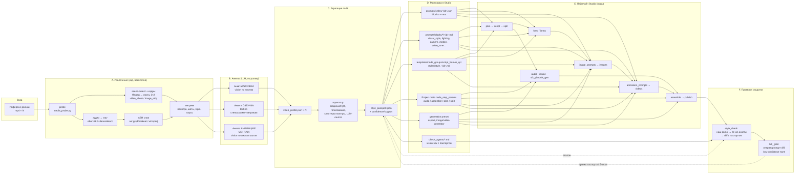

# Агент разбора стиля референсных роликов → воспроизведение в Studio

> **Статус:** дизайн одобрен, **первая реализация в ветке** (2026-10-16).
> Платные API в тестах не вызываются (LLM замокан). Что реально сделано и
> где лежит — §7 «Реализация»; расхождения с первоначальным планом там же.
> Имена нод, сервисов и файлов — реальные, из дерева репозитория (`housepc`).

Задача пользователя: взять ряд чужих роликов, разобрать их по трём осям —
**рисовка**, **озвучка**, **анимация/монтаж** — и собрать цепочку нод, которая
делает ролики того же стиля на наши темы. Нужен агент со структурой, который
делает разбор **повторяемо** (одинаковая анкета на каждый ролик), отделяет
устойчивое от случайного и выдаёт артефакт, который наш пайплайн умеет есть.

Ключевое решение: результат разбора — один JSON **«паспорт стиля»**
(`style_passport.json`), а не свободный текст. Паспорт «раскладывается» по
существующим точкам входа Studio: пресет `prompts/styles/<id>.json`
(blocks v2 + vars), файлы блоков `prompts/blocks/<category>/<name>.md`,
стиль-файл `templates/node_groups/script_frames_qc/styles/style_<id>.md`,
`Project.meta.node_step_params` (голос, BGM, субтитры), настройки генерации
(`generation_config_presets`). Так ни одна нода не узнаёт о новом формате —
они продолжают читать то, что читают сейчас.

---

## 0. Как читать документ

| Раздел | Ответ на вопрос |
|---|---|
| §1 | Как разбирать ролик: кадры/звук/речь, инструменты, анкета по осям, устойчивое vs случайное |
| §2 | Архитектура агента разбора: шаги, входы/выходы, схема паспорта (JSON) |
| §3 | Как воспроизводить в Studio: какие ноды переиспользуем, какие добавляем, куда подаётся паспорт |
| §4 | Контур проверки сходства (оригинал ↔ наш ролик) |
| §5 | Риски и стоимость |

Схема всего контура — §2.1 (mermaid).

---

## 1. Метод разбора

### 1.1. Принцип: ролик → измеримые признаки → анкета → паспорт

Разбор идёт в два слоя:

1. **Детерминированный слой (код, бесплатно).** ffmpeg/ffprobe, PIL, ASR,
   простые численные метрики. Даёт факты: длительность, формат, частота
   склеек, палитра, темп речи, паузы, громкость, доля времени с движением
   камеры. Это «линейка» — по ней видно, что устойчиво.
2. **Семантический слой (vision/text LLM).** Описывает то, что числами не
   возьмёшь: медиум рисовки, манера линии, тип освещения, драматургия,
   интонация диктора, характер движения. LLM получает **контрольные листы
   кадров** (не видео), стенограмму и численные метрики, и отвечает
   **строго по анкете** (JSON-схема), а не свободным эссе.

Оба слоя дают оценку **по каждому ролику отдельно**, затем агрегатор сводит
их по N роликам (§1.6).

### 1.2. Извлечение материала (ось → что берём → чем)

| Ось | Из ролика берём | Инструмент (есть в репо / ставится) |
|---|---|---|
| Общее | длительность, разрешение, aspect, fps | `app/services/media_probe.py` (`probe_duration`, `probe_video_size`) — обёртки ffprobe |
| Рисовка | кадры-ключевики: по 1 центру каждой «сцены» + равномерная сетка | ffmpeg `select='gt(scene,0.3)'` для границ склеек; `showinfo`; сборка листов — `app/services/image_strip.py` (`compose_grid_strip`, `compose_horizontal_strip`, бёрн подписи кадра) и `app/services/video_sheet.py` (6 кадров 3×2 — тот же формат, который уже читает агент `templates/check_agents/vision_videos_check.md`) |
| Рисовка | палитра (доминанты, насыщенность, контраст) | PIL (`Image.quantize`, гистограмма HSV) — зависимость уже есть |
| Анимация | частота склеек, средняя длина шота, доля «статики» | ffmpeg scene-detect (как выше) + межкадровая разница (PIL/numpy по downscale-кадрам) |
| Анимация | тип движения камеры в шоте (push-in / pan / static / parallax) | детерминированно — грубая оценка по оптическому потоку downscale-кадров (вектор смещения центроида); точнее — vision LLM по полосе 6 кадров шота (`video_sheet`) |
| Анимация/монтаж | субтитры: есть ли, стиль (слово / строка), положение | кадры в нижней трети + vision LLM; у нас свой рендер ASS — `app/services/subtitles.py`, `assembly.subtitle_layout` |
| Озвучка | дорожка речи отдельно от музыки | ffmpeg `-vn` → wav; разделение речь/музыка — опционально (demucs/`spleeter`, тяжёлая зависимость; на первом этапе — без разделения, ASR устойчив к фону) |
| Озвучка | стенограмма с таймкодами слов | `app/services/asr.py` → `transcribe_words` (NVIDIA Parakeet, `ASR_BACKEND=nvidia`) или faster-whisper fallback (`app/services/whisper.py`) — **уже установлены на ПК монтажа** |
| Озвучка | темп (слов/мин, знаков/сек), паузы, ритм фраз | по `WordTS` из ASR: `app/services/mapper.py` уже считает окна слов; нужны новые агрегаты (§2.3) |
| Озвучка | громкость/динамика, доля речи vs музыки | ffmpeg `loudnorm`/`ebur128` (LUFS, LRA), `silencedetect` |
| Озвучка | пол/возраст/тембр/интонация диктора | текстовое описание через LLM по стенограмме + метрикам; числовой тембр — опционально (эмбеддинги speaker-модели; пока не берём, см. §5) |
| Музыка | жанр, темп (BPM), настроение, присутствие SFX | ffmpeg (`ebur128` на отрезках без речи); BPM — `librosa` (новая зависимость, опционально); описание — LLM по метрикам + 2–3 коротких audio-фрагмента, если доступна аудио-модальность (см. §5) |
| Текст | хук первых 3 сек, структура, CTA, ключевые обороты | LLM по стенограмме — у нас уже есть блоки `narrative_structure`, `script_voice_tone`, `forbidden_phrases` — анкета спрашивает именно в этих терминах |

Важно: **видео в LLM целиком не отправляем.** `gpt_api.py` инлайнит mp4 только
до 400 КБ (`_MAX_BINARY_INLINE_BYTES`), а vision-вход — до 8 картинок за вызов
(`style_analyzer.BATCH_SIZE`). Поэтому единица анализа для vision — **лист
кадров** (grid 3×2 или полоса), как уже делает `vision_videos_check`.

### 1.3. Анкета по оси «Рисовка» (vision, по листам кадров)

Основа — критерии, уже зашитые в `style_analyzer._NOTES_SYSTEM`
(`palette / line / light / composition / subjects / mood / forbidden`),
расширенные под видео:

| Поле | Что спрашиваем | Куда ляжет в Studio |
|---|---|---|
| `medium` | медиум/техника: акварель, пиксель-арт, 3D, фото, вектор, textile… | блок `visual_style` |
| `palette` | 5–8 доминант **hex** (из детерминированного слоя), насыщенность, контраст, температура | блок `visual_style` («exactly hex #…» — правило из `_AGENT_SYSTEM`) |
| `line` | контур/штрих/текстура, медиум поверхности | `visual_style` |
| `light` | тип освещения по словарю `prompts/scene_design/style.md` (soft diffused / hard directional / low-key / …) | блок `lighting` |
| `composition` | кадрирование, доля крупных планов, глубина (планы), центровка | блоки `composition`, `camera_framing`, `background_density` |
| `subjects` | как нарисованы фигуры (пропорции, лица, анатомия) — **без сюжета** | `character_anatomy`, `img_hero_policy` |
| `world` | тип мира (люди/антропоморфные животные/предметы), эпоха — только если устойчив | блок `world` |
| `text_on_screen` | есть ли текст/лого внутри картинки (не субтитры) | `negative` (`no_text_logos`) или наоборот разрешение |
| `forbidden` | чего на референсах нет и что сломает стиль | `negative`, `anim_negative` |
| `aspect` | 9:16 / 16:9 / 1:1 | `vars.ASPECT_RATIO_VIDEO`, пресет генерации |

Запрет из `style_analyzer`: тема ролика (о чём) в анкету рисовки **не
попадает** — тема всегда приходит из нашей `topic`. `scrub_style_topic` /
`is_topic_clause` переиспользуем для чистки ответов.

### 1.4. Анкета по оси «Озвучка»

| Поле | Источник | Куда ляжет |
|---|---|---|
| `voice.gender`, `voice.age_band`, `voice.timbre` | LLM по стенограмме + метрикам; оператор подтверждает | выбор из `ELEVENLABS_VOICES` (`app/services/elevenlabs_voices.py`) → `meta.node_step_params.audio.elevenlabs_voice_id` |
| `voice.pace_wpm`, `voice.chars_per_sec` | ASR `WordTS` | `node_step_params.plan/script.duration_seconds` и константа `CHARS_PER_SEC` (сейчас 14 — хардкод в `node_step_params.py`) |
| `voice.pause_profile` | ASR: распределение пауз между фразами (медиана, p90) | `split` — лимиты ячейки (`cell_min_chars/cell_max_chars`), субтитры (`subtitle_lead_seconds`) |
| `voice.intonation` | LLM: ровный/нарастающий/«подкаст»/«триллер» | блоки `voice_tone`, `script_voice_tone`, `plan_voice_tone` |
| `voice.delivery_markers` | LLM: обращение на «ты/вы», риторические вопросы, повторы, хук первых 3 сек | блоки `script_narrative_structure`, `narrative_structure`, `forbidden_phrases` |
| `voice.tts_params` | подбор `stability` / `similarity_boost` под «ровность» (`elevenlabs_api.synthesize`) — сейчас хардкод 0.5/0.75 | **[новое]** параметры ноды `audio` |
| `music.role`, `music.bpm`, `music.genre`, `music.level_vs_voice_db` | ebur128/LRA + LLM | `node_step_params.assemble.bgm_level`, промт шага `music` (`gpt_text_builder` → Suno) |
| `sfx.density`, `sfx.kinds` | LLM по описанию + `silencedetect` | `sfx_plan` — каталог `SFX_KINDS` (`app/services/sfx_plan.py`), `MAX_EVENTS_PER_FRAME` |
| `subtitles.enabled/style` | vision по нижней трети кадров | `subtitles_enabled_for_project`, `settings.subtitle_max_words` |
| `language` | ASR | язык скрипта/TTS модели (`eleven_multilingual_v2`) |

### 1.5. Анкета по оси «Анимация и монтаж»

| Поле | Источник | Куда ляжет |
|---|---|---|
| `shot.len_median_s`, `shot.len_p10/p90` | scene-detect | `vars.FRAME_DURATION_MIN_SEC/MAX_SEC`, `VIDEO_DURATION_MAX_SEC`, `split` (кадров на ролик) |
| `shot.static_ratio` | межкадровая разница | решение «картинка+Ken Burns в сборке» vs «видеоген на каждый кадр» (ноды `videos` / `freeze_stills.py`) |
| `camera.motion_vocab` | vision по 6-кадровым листам: push-in / pull-out / pan / tilt / parallax / handheld / static | блок `camera_motion` (сейчас один вариант `slow_push_in.md`), `anim_motion_layers` |
| `camera.framing_vocab` | vision: доля close/medium/full | `camera_framing` (`medium_full_mix.md`), `scene_design/camera.md` — словарь планов уже есть |
| `motion.subject_vs_camera` | vision: двигается герой, камера или только фон | `anim_motion_layers` (`three_plane_motion.md`) |
| `transitions.kind` | scene-detect + vision: cut / dissolve / whip / zoom-cut | `assemble` — сейчас только cut; остальное **[новое]** |
| `montage.hook_structure` | стенограмма + склейки первых 3–5 сек | `narrative_structure` (`shorts_hook_insight.md`) |
| `montage.vo_to_cut_sync` | корреляция границ фраз (ASR) и склеек | правило `split`: 1 ячейка закадра = 1 сцена (уже наше, см. `scene-design-model`) |
| `total.duration_s` | ffprobe | `vars.VIDEO_DURATION_SEC`, `node_step_params.plan.duration_seconds`, harness `assemble` (сейчас 60–75 с — надо параметризовать) |
| `end_card` | есть ли финальная плашка/CTA | блок `plan_structure` / `publish` |

### 1.6. Как отделять устойчивый стиль от случайного (по N роликам)

Это главное отличие от текущего `style_analyzer`, который сразу синтезирует
одну запись. Делаем в три шага:

1. **Per-video паспорта.** Каждый ролик → свой `video_profile.json` по одной
   и той же анкете (поля всегда одни и те же, пустое = `null`). Никаких
   «общих выводов» на этом шаге.
2. **Агрегация по типам полей** (код, без LLM):
   - **Числовые** (длина шота, wpm, LUFS, BPM, доля статики): медиана и
     межквартильный размах. Поле считается устойчивым, если
     `IQR / median < 0.35` (порог настраиваемый). Иначе — диапазон, и в
     паспорт идёт `range`, а не точка.
   - **Категориальные** (медиум, пол диктора, тип света, aspect): голосование;
     устойчиво при доле ≥ 0.7 роликов. Ниже — поле помечается `variable` и
     в паспорт попадают **все** встреченные значения с частотами.
   - **Палитра:** объединяем hex всех роликов, кластеризуем (k-means по Lab,
     k = 6–8), оставляем кластеры, встречающиеся в ≥ 70 % роликов.
   - **Текстовые описания** (line/subjects/intonation): собираем все
     per-video ответы и просим LLM-синтезатор (как `_SYNTH_SYSTEM`) оставить
     **только то, что повторяется в большинстве заметок**, и явно вынести
     расхождения в `variance_notes`.
3. **Метка уверенности** на каждое поле паспорта: `confidence ∈ {high,
   medium, low}` + `support = k/N`. Ноды-потребители (через раскладку §3.4)
   используют только `high/medium`; `low` показывается оператору как вопрос
   в HITL-ноде (`hitl_gate`).

Минимум для осмысленной статистики — **3 ролика**, рекомендовано 5–8. При
N = 1 агент работает, но весь паспорт получает `confidence=low`, и
оператор это видит.

Отдельно — **фильтр сюжета**: всё, что про предмет/тему ролика (кто герой,
о чём речь), в стиль не попадает. Используем `style_analyzer.is_topic_clause`
+ инструкцию в анкете. Исключение — поле `world` (тип мира), если он
устойчив по N роликам (например, все ролики про антропоморфных котов —
это стиль, а не тема, как в `prompts/styles/cats_pixelart_short.json`).

---

## 2. Архитектура агента разбора

### 2.1. Схема контура (разбор → паспорт → воспроизведение → проверка)



### 2.2. Шаги агента, входы и выходы

Агент — **детерминированный раннер + 4 LLM-роли**, а не один «умный чат».
Каждый шаг идемпотентен и кладёт результат на диск (паттерн чекпоинтов из
`NODE_SYSTEM.md` §7): повторный запуск не пересчитывает готовое.

| # | Шаг | Вход | Выход (на диске) | Кто |
|---|---|---|---|---|
| A1 | `probe` | `refs/*.mp4` | `analysis/<vid>/probe.json` | код (`media_probe`) |
| A2 | `shots` | mp4 | `analysis/<vid>/shots.json` (границы, длины), `sheets/sheet_NNN.png` (3×2 на шот), `keyframes/` | код (ffmpeg, `image_strip.compose_grid_strip`) |
| A3 | `audio` | mp4 | `analysis/<vid>/audio.wav`, `loudness.json`, `silence.json` | код (ffmpeg) |
| A4 | `asr` | wav | `analysis/<vid>/words.json` (формат `WordTS`, как `dump_words_json`) | код (`asr.transcribe_words`) |
| A5 | `metrics` | A1–A4 | `analysis/<vid>/metrics.json` (палитра hex, shot stats, wpm, паузы, LUFS, доля статики, субтитры да/нет) | код |
| B1 | `q_visual` | листы кадров (пачками ≤ 8), `metrics.palette` | `analysis/<vid>/q_visual.json` | vision LLM, системный промт = анкета §1.3 |
| B2 | `q_voice` | стенограмма + `metrics` (wpm, паузы, LUFS) | `analysis/<vid>/q_voice.json` | text LLM, анкета §1.4 |
| B3 | `q_motion` | листы шотов + `shots.json` | `analysis/<vid>/q_motion.json` | vision LLM, анкета §1.5 |
| B4 | `profile` | B1–B3 + A5 | `analysis/<vid>/video_profile.json` | код (склейка, валидация схемы) |
| C1 | `aggregate` | `video_profile.json × N` | `style_passport.draft.json` + `variance_report.md` | код (медиана/IQR/голосование/кластеры) + 1 LLM-вызов синтеза текстовых полей |
| C2 | `review` | draft + variance | `style_passport.json` (approved) | **человек** (HITL): правит/подтверждает `low`-поля |
| D1 | `materialize` | passport | файлы §3.4 | код, без LLM (кроме D2) |
| D2 | `compile_blocks` | passport | тексты блоков `.md` (EN-ядро + «Не …») | LLM по правилам `style_analyzer._AGENT_SYSTEM` / `meta_prompt_compiler` |

Правила надёжности, взятые из существующего кода:

- Vision-пачки ≤ 8 изображений, параллельно со stagger 5 с
  (`style_analyzer.analyze_style_images`).
- Ответ LLM — **строго JSON** по схеме; парсим `ai_result_io.parse_json_object`
  / `style_analyzer.parse_json_object`; нечитаемый ответ → один форматный retry
  → пропуск пачки с warning (не падение всего разбора).
- Все LLM-вызовы — через `gpt_client.get_gpt_client().ask_with_files`
  (relay vibecode, `VIBECODE_API_KEY`), модель — из пикера ноды
  (`llm_override`), дефолт `gpt-5.6-sol`; для дешёвого прогона — `gemini-3-flash`
  / `gpt-5.6-luna` (см. `NODE_MODELS.md`).

### 2.3. Паспорт стиля — схема JSON

Файл: `data/videos/<slug>/style/style_passport.json` (проект-владелец — тот,
в котором стоит нода разбора) + копия в библиотеку
`prompts/styles/passports/<style_id>.json` **[новое]** для переиспользования
другими проектами.

Каждое «листовое» поле — объект `{value, confidence, support, note}`;
для краткости ниже показано как `value` с пометкой уверенности в
комментарии. Полная схема:

```json
{
  "$schema": "style_passport/v1",
  "style_id": "noir_doc_shorts_v1",
  "label": "Нуарный док-шортс",
  "created_at": "2026-10-16T19:00:00Z",
  "sources": {
    "count": 6,
    "videos": [
      {"id": "ref_01", "file": "refs/ref_01.mp4", "duration_s": 58.4, "aspect": "9:16", "profile": "analysis/ref_01/video_profile.json"}
    ],
    "min_support_for_stable": 0.7,
    "numeric_iqr_threshold": 0.35
  },

  "format": {
    "aspect":         {"value": "9:16",  "confidence": "high", "support": "6/6"},
    "duration_s":     {"value": {"median": 61, "p10": 52, "p90": 74}, "confidence": "high", "support": "6/6"},
    "fps":            {"value": 30, "confidence": "high", "support": "6/6"},
    "resolution":     {"value": "1080x1920", "confidence": "high", "support": "5/6"}
  },

  "visual": {
    "medium":         {"value": "archival noir watercolor + ink, distressed paper", "confidence": "high", "support": "6/6"},
    "palette_hex":    {"value": ["#2B3A4A", "#6B7B8C", "#D9CDB8", "#1A1A1A", "#8A2F2A"], "confidence": "high", "support": "5/6",
                       "note": "красный — редкий акцент (<5% площади)"},
    "saturation":     {"value": "low", "confidence": "high", "support": "6/6"},
    "contrast":       {"value": "high", "confidence": "high", "support": "6/6"},
    "line":           {"value": "rough ink contour, charcoal shadow masses, halftone grain", "confidence": "medium", "support": "4/6"},
    "light":          {"value": "low-key, single hard directional source, backlight rim", "confidence": "high", "support": "5/6"},
    "composition":    {"value": "single unified frame, subject off-centre, 3-plane depth", "confidence": "medium", "support": "4/6"},
    "framing_mix":    {"value": {"close": 0.35, "medium": 0.45, "full": 0.20}, "confidence": "medium", "support": "6/6"},
    "subjects":       {"value": "realistic proportions, faces half in shadow, no cartoon exaggeration", "confidence": "high", "support": "6/6"},
    "world":          {"value": "humans, mid-20th-century, documentary", "confidence": "medium", "support": "4/6",
                       "note": "2 ролика — современность; тема не фиксируется"},
    "text_in_image":  {"value": false, "confidence": "high", "support": "6/6"},
    "forbidden":      {"value": ["photorealism", "glossy 3D", "neon", "pastel", "clean vector", "multi-panel collage"], "confidence": "high", "support": "6/6"},
    "variance_notes": ["ref_03 и ref_05 — тёплая сепия вместо холодного серо-синего (не включено в ядро)"]
  },

  "voice": {
    "language":       {"value": "ru", "confidence": "high", "support": "6/6"},
    "gender":         {"value": "male", "confidence": "high", "support": "6/6"},
    "age_band":       {"value": "35-50", "confidence": "medium", "support": "5/6"},
    "timbre":         {"value": "deep, calm, slightly hoarse", "confidence": "medium", "support": "4/6"},
    "intonation":     {"value": "even documentary, rising on reveal, no shouting", "confidence": "high", "support": "6/6"},
    "pace_wpm":       {"value": {"median": 148, "iqr": 12}, "confidence": "high", "support": "6/6"},
    "chars_per_sec":  {"value": 13.6, "confidence": "high", "support": "6/6"},
    "pause_profile":  {"value": {"median_s": 0.45, "p90_s": 1.1, "long_pause_before_reveal": true}, "confidence": "medium", "support": "5/6"},
    "address":        {"value": "вы, редкие риторические вопросы", "confidence": "medium", "support": "4/6"},
    "hook_first_3s":  {"value": "утверждение-парадокс без приветствия", "confidence": "high", "support": "6/6"},
    "cta":            {"value": "нет", "confidence": "high", "support": "5/6"},
    "tts_hint":       {"value": {"elevenlabs_voice_id": "nPczCjzI2devNBz1zQrb", "stability": 0.65, "similarity_boost": 0.8},
                       "confidence": "low", "support": "manual", "note": "подбор оператором из ELEVENLABS_VOICES"}
  },

  "music": {
    "present":        {"value": true, "confidence": "high", "support": "6/6"},
    "genre":          {"value": "dark ambient, sparse piano, low drone", "confidence": "medium", "support": "4/6"},
    "bpm":            {"value": {"median": 72, "iqr": 10}, "confidence": "medium", "support": "5/6"},
    "level_vs_voice_db": {"value": -18, "confidence": "high", "support": "6/6"},
    "suno_prompt_core": {"value": "slow dark ambient underscore, low drone, sparse piano, no drums, cinematic tension", "confidence": "medium", "support": "synth"}
  },

  "sfx": {
    "density_per_min": {"value": 3, "confidence": "medium", "support": "5/6"},
    "kinds":           {"value": ["riser", "hit", "ambience"], "confidence": "medium", "support": "5/6"}
  },

  "motion": {
    "shot_len_s":     {"value": {"median": 3.2, "p10": 2.0, "p90": 5.5}, "confidence": "high", "support": "6/6"},
    "static_ratio":   {"value": 0.15, "confidence": "high", "support": "6/6"},
    "camera_vocab":   {"value": {"slow_push_in": 0.55, "parallax_pan": 0.25, "static": 0.15, "handheld": 0.05}, "confidence": "high", "support": "6/6"},
    "subject_motion": {"value": "minimal; smoke, dust, light flicker; no lip-sync", "confidence": "high", "support": "6/6"},
    "transitions":    {"value": {"cut": 0.9, "dissolve": 0.1}, "confidence": "high", "support": "6/6"},
    "vo_cut_sync":    {"value": "cut on phrase boundary", "confidence": "high", "support": "5/6"},
    "subtitles":      {"value": {"enabled": true, "mode": "word", "position": "lower_third", "style": "bold sans, white, black outline"}, "confidence": "high", "support": "6/6"},
    "end_card":       {"value": false, "confidence": "high", "support": "6/6"}
  },

  "narrative": {
    "structure":      {"value": "hook → context → reveal → consequence", "confidence": "high", "support": "6/6"},
    "forbidden_phrases_seed": {"value": ["в этом видео", "давайте разберёмся", "подпишись"], "confidence": "medium", "support": "4/6"}
  },

  "mapping": {
    "style_preset":        "prompts/styles/noir_doc_shorts_v1.json",
    "blocks": {
      "visual_style":        "noir_doc_shorts_v1",
      "lighting":            "noir_doc_shorts_v1",
      "negative":            "noir_doc_shorts_v1",
      "composition":         "noir_doc_shorts_v1",
      "camera_framing":      "noir_doc_shorts_v1",
      "camera_motion":       "noir_doc_shorts_v1",
      "anim_motion_layers":  "noir_doc_shorts_v1",
      "anim_negative":       "noir_doc_shorts_v1",
      "voice_tone":          "noir_doc_shorts_v1",
      "script_voice_tone":   "noir_doc_shorts_v1",
      "plan_voice_tone":     "noir_doc_shorts_v1",
      "narrative_structure": "noir_doc_shorts_v1",
      "script_narrative_structure": "noir_doc_shorts_v1",
      "forbidden_phrases":   "noir_doc_shorts_v1",
      "world":               "humans_realistic",
      "character_anatomy":   "noir_doc_shorts_v1"
    },
    "vars": {
      "VIDEO_DURATION_SEC": 61, "ASPECT_RATIO_VIDEO": "9:16", "ASPECT_RATIO_HERO": "16:9",
      "VOICEOVER_MIN_CHARS": 780, "VOICEOVER_MAX_CHARS": 880,
      "FRAME_DURATION_MIN_SEC": 2, "FRAME_DURATION_MAX_SEC": 5, "VIDEO_DURATION_MAX_SEC": 8
    },
    "frame_style_file":    "templates/node_groups/script_frames_qc/styles/style_noir_doc_shorts_v1.md",
    "node_step_params": {
      "plan":     {"duration_seconds": 61},
      "split":    {"cell_min_chars": 45, "cell_max_chars": 95},
      "audio":    {"elevenlabs_voice_id": "nPczCjzI2devNBz1zQrb"},
      "assemble": {"bgm_level": 22, "subtitles": true}
    },
    "generation_preset":   {"aspect_ratio": "9:16", "image_generator": "gpt_image_2_vip", "video_generator": "veo_3_1_lite", "video_resolution": "720p"},
    "check_agent":         "templates/check_agents/style_check_noir_doc_shorts_v1.md"
  }
}
```

Замечания к схеме:

- `support` — строка `k/N`, чтобы оператор видел «4 из 6», а не 0.67.
- Поля `confidence=low` **не материализуются автоматически** (D1 пропускает
  их, оставляя дефолт блока/вара); они попадают в `variance_report.md` и
  в HITL-карточку.
- `mapping` заполняется агентом на шаге C1, но правится человеком на C2:
  например, `world` оставлен существующим `humans_realistic`, а не новым.
- `voice.tts_hint` всегда `support=manual`: автоматически определять
  голос ElevenLabs по чужой дорожке мы не умеем (и не хотим клонировать голос,
  см. §5 про права).

### 2.4. Где живут промты агента

По правилу репо «ничего не зашито в код» (`PROMPTS_BLOCKS.md` §1):

- `prompts/style_agent/orchestrator.md` (общие правила группы) +
  `visual.md`, `voice.md`, `motion.md`, `narrative.md`, `synth.md` —
  анкеты специалистов как системные промты (реализовано; системный промт
  = orchestrator + роль, см. `style_agent/agents.py:system_prompt`).
- Каждая анкета заканчивается блоком **«ФОРМАТ ВЫВОДА: строго JSON по
  схеме …»** и анти-сюжетным запретом (как `_NOTES_SYSTEM`).

---

## 3. Воспроизведение в Studio

### 3.1. Принцип раскладки

Пайплайн Studio **уже параметризован стилем** в четырёх местах — паспорт лишь
заполняет их:

| Канал | Что это | Кто читает | Что кладёт паспорт |
|---|---|---|---|
| **Пресет blocks v2** | `prompts/styles/<id>.json` = `{blocks, vars}`; включается `Project.prompt_overrides.style_profile` (`prompt_composer.merge_project_prompt_config`) | все текстовые ноды с `steps/<id>/template.md`: `plan`, `script`, `split`, `hero`, `items`, `image_prompts`, `animation_prompts`, `enrich_*` | `mapping.style_preset` + новые файлы блоков |
| **Файлы блоков** | `prompts/blocks/<category>/<name>.md` | те же через `{{BLOCK:cat}}` | `visual_style`, `lighting`, `negative`, `composition`, `camera_framing`, `camera_motion`, `anim_motion_layers`, `anim_negative`, `voice_tone`, `script_voice_tone`, `plan_voice_tone`, `narrative_structure`, `script_narrative_structure`, `forbidden_phrases`, `character_anatomy`, `background_density` |
| **Стиль-файл ноды «Стиль»** | `templates/node_groups/script_frames_qc/styles/style_<id>.md` → нода `n_excel_gpt_fw_style` (`app/services/frame_style.py`, код без LLM) дописывает его к `промт_картинки` K1 | группа `script_frames_qc` (Каркас → Площадка → Шоты → QC → **Стиль** → Отчёт) | `mapping.frame_style_file` (EN-ядро + Final style lock + Negative, ≤ 4677 знаков — `max_style_chars`) |
| **`Project.meta.node_step_params`** | параметры нод без промтов | `audio` (`elevenlabs_voices.resolve_elevenlabs_voice_id`), `assemble` (`assemble_bgm_level_from_meta`, `subtitles_enabled_for_project`), `plan`/`script` (`duration_seconds_for_step`), `split` (`split_cell_limits_from_project`) | `mapping.node_step_params` |
| **Пресет генерации** | `generation_config_presets.PRESET_FIELDS` (генератор картинок/видео, aspect, разрешение) | ноды `hero`, `items`, `images`, `videos` через `generation_options` | `mapping.generation_preset` |
| **Vision-чек агенты** | `templates/check_agents/*.md` для `excel_gpt` с `checkMode` (цикл `vision_check_loop`) | проверки после `hero` / `images` / `videos` | `mapping.check_agent` — чек-лист сходства со стилем |

### 3.2. Какие ноды переиспользуем (как есть)

| Нода (тип / step) | Что получает от паспорта | Через что |
|---|---|---|
| `topic` | ничего (тема — наша) | — |
| `plan` (`plan`) | длительность, тон, структура, запретные фразы | пресет: `plan_voice_tone`, `plan_structure`, `forbidden_phrases`; `node_step_params.plan.duration_seconds` |
| `script` (`script`) | объём текста под wpm, интонация, хук, структура | `vars.VOICEOVER_MIN/MAX_CHARS` (считаем = `duration × chars_per_sec`), блоки `script_voice_tone`, `script_narrative_structure`, `script_anti_gpt_patterns` |
| `split` (`split`) | длина ячейки ↔ длина шота | `split.cell_min/max_chars` = `shot_len × chars_per_sec`; `vars.FRAME_DURATION_*` |
| группа `script_frames_qc` (Каркас → Площадка → Шоты → QC → Стиль → Отчёт; `node_groups.py`) | словарь планов/движений для «Шотов», стиль для K1 | `scene_design/camera.md` получает `framing_mix`, `camera_vocab` как «СТИЛЬ ПРОЕКТА» (вход агента style: «если задан извне — не меняй, разложи дугу внутри»); `style_<id>.md` для `fw_style` |
| веер `scene_design_fanout` (`sd_agent` × skeleton/characters/world/camera/action → `sd_assemble`) | то же, если проект на веере, а не на `script_frames_qc` | блок «СТИЛЬ ПРОЕКТА» в промтах `prompts/scene_design/*.md` |
| `hero` (`hero`) / `items` (`items`) | медиум, палитра, анатомия, свет, негатив | пресет: `visual_style`, `character_anatomy`, `lighting`, `negative`, `composition`; `04_hero_style` вариант — компилируется из паспорта (`meta_prompt_compiler`, гайд `hero_style`) |
| `image_prompts` (`img_pr`) | полный визуальный профиль | пресет: `visual_style`, `composition`, `camera_framing`, `background_density`, `lighting`, `negative`, `world`, `character_anatomy` |
| `images` (`img`) | aspect, генератор | пресет генерации |
| `animation_prompts` (`anim_pr`) | словарь камеры, слои движения, длительность клипа, негатив | пресет: `camera_motion`, `anim_motion_layers`, `anim_negative`, `anim_output_contract`; `vars.VIDEO_DURATION_MAX_SEC` |
| `videos` (`video`) | генератор, разрешение | пресет генерации (`veo_3_1_lite` / `kling_2_6`) |
| `audio` (`audio`) | голос | `node_step_params.audio.elevenlabs_voice_id` (из `ELEVENLABS_VOICES`) |
| `music` (`music`) | ядро промта для Suno | сопроводительный текст шага (`gpt_text_builder`), `vars` **[новое]** `MUSIC_STYLE_CORE` |
| `sfx_plan` / `sfx_gen` | плотность и виды | ограничение каталога `SFX_KINDS` и `MAX_EVENTS_PER_FRAME` через параметры ноды **[новое]** |
| `assemble` (`assemble`) | уровень BGM, субтитры да/нет | `node_step_params.assemble.bgm_level`, `subtitles` |
| `excel_gpt` + `checkMode` (vision) | чек-лист сходства | `templates/check_agents/style_check_<id>.md` |
| `hitl_images` / `hitl_videos` / `hitl_final` / `hitl_gate` | аппрув оператором с diff-отчётом | §4 |
| `storage` | приём референс-роликов (`formats=video`) и хранение `analysis/` | `storage_node.py` — уже принимает mp4 со стрелок/загрузкой |

### 3.3. Какие ноды/сервисы добавить [новое]

Минимальный набор, чтобы цикл замкнулся. Все — в существующих категориях
палитры (`node-catalog.ts`), без нового транспорта.

| Нода / сервис | Тип | Что делает | Вход → выход |
|---|---|---|---|
| **`style_extract`** | work-нода (`node_registry.WORK_NODES`, новый `step_code=style_x`), категория `planning` | Шаги A1–A5 + B1–B4 §2.2 для каждого mp4 из входящей `storage`-ноды. Идемпотентна по хэшу файла | `storage(video)` → `analysis/<vid>/video_profile.json` + листы |
| **`style_passport`** | work-нода (`style_pp`) | Шаг C1: агрегация по N профилям + LLM-синтез текстовых полей; пишет `style_passport.draft.json`, `variance_report.md` | `style_extract` → draft |
| **`hitl_style`** | HITL-нода (`HITL_NODE_TYPES`), категория `hitl` | Шаг C2: карточка паспорта с полями, `confidence`, `support`, выбор голоса из `ELEVENLABS_VOICES`, правка `mapping`. Resume → approved | draft → `style_passport.json` |
| **`style_apply`** | work-нода (`style_ap`), код без LLM (+ один LLM-вызов компиляции блоков D2) | Шаг D1/D2: материализует `mapping` — пишет `prompts/styles/<id>.json`, `prompts/blocks/*/<id>.md`, `style_<id>.md`, патчит `Project.prompt_overrides` (`style_profile`, `use_blocks_v2=true`), `meta.node_step_params`, сохраняет пресет генерации. Backup старых файлов в `old/` | passport → файлы + meta |
| **`style_check`** | `excel_gpt` с `checkMode` + новый `vision_check_kind="style"` в `vision_check_loop.py` | §4: прогоняет по нашему ролику те же анкеты, считает diff с паспортом, отчёт + `db_patch` при критичных расхождениях | финальный mp4 / `scenes/*.png` / `videos/*.mp4` → `style_check_report.json` |
| сервис `app/services/style_extract.py` | код | ffmpeg scene-detect, листы, палитра, метрики; обёртки над `media_probe`, `image_strip`, `video_sheet`, `asr` | — |
| сервис `app/services/style_passport.py` | код | схема v1, валидация, агрегатор (медиана/IQR/голосование/кластеры), сериализация | — |
| сервис `app/services/style_apply.py` | код | материализация `mapping`, обратимость (backup) | — |
| промты `prompts/style_agent/*.md` | файлы | анкеты и синтез (§2.4) | — |
| группа **`style_clone`** в `node_groups.NODE_GROUPS` | пресет «+ Группа» | `storage(video) → style_extract → style_passport → hitl_style → style_apply`, `default_after_type="topic"`, `exit_key="style_apply"` | вставляется одним кликом перед `plan` |

Что при этом **придётся параметризовать** в существующем коде (сейчас
хардкод; без этого паспорт частично не применится):

- `node_step_params.CHARS_PER_SEC = 14` → брать из паспорта
  (`voice.chars_per_sec`) с дефолтом 14.
- Harness `assemble` «60–75 с» (`NODE_SYSTEM.md` §6) → диапазон из
  `format.duration_s.p10/p90`.
- `elevenlabs_api.synthesize(stability=0.5, similarity_boost=0.75)` →
  из `node_step_params.audio`.
- `assemble`: только `cut`. Если паспорт требует `dissolve`/Ken Burns на
  статиках (`static_ratio` высок) — расширение `assembly.py` (xfade/zoompan);
  иначе поле паспорта игнорируется с warning в отчёте.
- `camera_motion`: сейчас один блок `slow_push_in.md`; агент генерирует
  блок с распределением (`camera_vocab`), а `anim_pr` промт должен уметь
  «раздать» движения по кадрам в заданной пропорции — правка
  `prompts/steps/07_animation/template.md` (блок 3) и
  `animation_prompt_gpt.py` при необходимости.

### 3.4. Как паспорт подаётся в каждую ноду (поле → место)

Таблица «одно поле — одно место», чтобы `style_apply` был прямолинейным:

| Поле паспорта | Место назначения | Нода-потребитель |
|---|---|---|
| `format.aspect` | `vars.ASPECT_RATIO_VIDEO`; `generation_preset.aspect_ratio` | `img_pr`, `anim_pr`, `images`, `videos` |
| `format.duration_s.median` | `vars.VIDEO_DURATION_SEC`; `node_step_params.plan.duration_seconds` | `plan`, `script` |
| `visual.medium/palette_hex/line/subjects/saturation/contrast` | `prompts/blocks/visual_style/<id>.md` (EN-ядро, hex как «exactly hex #…») | `hero`, `items`, `img_pr`, `anim_pr` |
| `visual.light` | `prompts/blocks/lighting/<id>.md` | `hero`, `img_pr`, `anim_pr` |
| `visual.composition`, `framing_mix` | `prompts/blocks/composition/<id>.md`, `camera_framing/<id>.md` | `img_pr`, «Шоты» |
| `visual.forbidden`, `text_in_image` | `prompts/blocks/negative/<id>.md`, `anim_negative/<id>.md` | `hero`, `img_pr`, `anim_pr` |
| `visual.world` (если `high/medium`) | `prompts/blocks/world/<id>.md` или существующий (`humans_realistic`, `cats_anthropomorphic`) | `hero`, `img_pr` |
| `visual.subjects` | `prompts/blocks/character_anatomy/<id>.md` | `hero`, `img_pr` |
| визуальное ядро целиком | `templates/node_groups/script_frames_qc/styles/style_<id>.md` (STYLE / Final style lock / Negative — формат как `style_archival_noir_watercolor_aug.md`) | `n_excel_gpt_fw_style` |
| `voice.intonation/address/hook_first_3s/cta` | `prompts/blocks/voice_tone/<id>.md`, `script_voice_tone/<id>.md`, `plan_voice_tone/<id>.md` | `plan`, `script` |
| `voice.pace_wpm`, `chars_per_sec` | `vars.VOICEOVER_MIN/MAX_CHARS`; `CHARS_PER_SEC` | `script`, `split` |
| `voice.pause_profile` | `split.cell_min/max_chars`; `settings.subtitle_lead_seconds` (пока глобально) | `split`, `assemble` |
| `voice.tts_hint` | `node_step_params.audio.{elevenlabs_voice_id, stability, similarity_boost}` | `audio` |
| `narrative.structure` | `prompts/blocks/narrative_structure/<id>.md`, `script_narrative_structure/<id>.md` | `plan`, `script` |
| `narrative.forbidden_phrases_seed` | `prompts/blocks/forbidden_phrases/<id>.md` (дополняет `ai_cliches_ru`) | `plan`, `script`, `split` |
| `music.*` | `vars.MUSIC_STYLE_CORE` → сопроводительный текст `music`; `node_step_params.assemble.bgm_level` ← `level_vs_voice_db` | `music`, `assemble` |
| `sfx.*` | параметры `sfx_plan` (`density_per_min`, разрешённые `kinds`) | `sfx_plan` |
| `motion.shot_len_s` | `vars.FRAME_DURATION_MIN/MAX_SEC`; `split` (число кадров ≈ duration / median) | `split`, `anim_pr`, `assemble` |
| `motion.camera_vocab`, `subject_motion` | `prompts/blocks/camera_motion/<id>.md`, `anim_motion_layers/<id>.md` | `anim_pr`, «Шоты» (`scene_design/camera.md` — словарь планов) |
| `motion.static_ratio` | решение `videos` vs `freeze_stills` на часть кадров (параметр ноды `videos`) | `videos`, `assemble` |
| `motion.transitions` | параметр `assemble` (если поддержано) | `assemble` |
| `motion.subtitles` | `node_step_params.assemble.subtitles`; `settings.subtitle_max_words` (1 = word-mode) | `assemble` |
| `motion.vo_cut_sync` | уже правило модели: 1 ячейка закадра = 1 сцена (`scene-design-model`) | `split`, «Шоты» |
| весь паспорт | `templates/check_agents/style_check_<id>.md` (контракт как `vision_videos_check.md`: `mode: report_only`, `## db_patch`, `[critical]`) | `style_check` |

Проекту достаточно `prompt_overrides.style_profile = "<id>"` и
`use_blocks_v2 = true` — всё остальное подтягивается
`merge_project_prompt_config`. Для Mass-фабрики (`mass_factory.py`) паспорт
копируется вместе со снапшотом `prompts/` (уже так делается для батчей,
`PROMPTS_BLOCKS.md` §7).

---

## 4. Контур проверки сходства

Цель — не «похоже/непохоже на глаз», а **тот же паспорт, снятый с нашего
ролика, и diff по полям**.

### 4.1. Три уровня проверки

| Уровень | Когда | Что сравниваем | Механизм |
|---|---|---|---|
| **L1. Картинки** | после `images` (и `hero`) | листы наших PNG ↔ `visual.*` паспорта | `excel_gpt` `checkMode`, агент `style_check_<id>.md` (наследует контракт `vision_png_check.md`), цикл `vision_check_loop` kind=`scenes`/`hero`: FAIL → `db_patch промт_картинки` → regen только критичных |
| **L2. Клипы** | после `videos` | 6-кадровые `video_sheet` ↔ `motion.*` + `visual.*` | тот же цикл kind=`videos`, агент дополнен полями паспорта (camera_vocab, subject_motion) |
| **L3. Финал** | после `assemble` | весь ролик прогоняется через **тот же `style_extract`** → `video_profile.json` нашего ролика ↔ `style_passport.json` | новый kind=`style`: код считает diff (§4.2), LLM пишет человеку отчёт; блокирующий гейт перед `publish` через `hitl_final`/`hitl_gate` |

L3 — самый ценный и почти бесплатный: детерминированные метрики (длина
шотов, wpm, LUFS, палитра, доля статики, субтитры) сравниваются кодом, LLM
нужен только на 1 вызов отчёта.

### 4.2. Метрика сходства

Для каждого поля паспорта с `confidence ∈ {high, medium}`:

- **Числовые:** `score = 1 − clamp(|ours − median| / (p90 − p10), 0, 1)`.
- **Категориальные/распределения** (`camera_vocab`, `framing_mix`,
  `transitions`): `score = 1 − 0.5·L1(ours, ref)`.
- **Палитра:** доля площади наших кадров, попавшая в кластеры палитры
  паспорта (ΔE в Lab ≤ 18).
- **Текстовые** (medium, line, intonation): vision/text LLM отвечает 0–1 с
  обоснованием по чек-листу, как `scores` в `vision_videos_check.md`.

Итог: взвешенная сумма по осям (`visual 0.4 / voice 0.25 / motion 0.25 /
music+sfx 0.1`, веса — в паспорте, правит оператор). Порог `pass ≥ 0.75`,
`warning 0.6–0.75`, `critical < 0.6` — та же шкала, что `overall ≥ 0.70` у
существующих vision-агентов, чтобы оператор не учил новую.

### 4.3. Что делаем при провале

| Ось провалена | Автодействие | Ручное |
|---|---|---|
| visual (L1/L2) | `db_patch` промта + regen критичных кадров (как сейчас) | усилить блок (`weight` ≥ 0.7 в `BlocksWeightPanel`), поправить `style_<id>.md` |
| motion (L2/L3) | перегенерация `anim_pr` для кадров с «чужим» движением | поправить `camera_motion/<id>.md` |
| voice (L3) | нет (TTS детерминирован) | сменить голос/`stability` в HITL-карточке, пересобрать `audio` |
| duration/pace (L3) | нет | пересчитать `VOICEOVER_*` vars → `script` заново |
| music (L3) | нет | уровень BGM в `assemble`, промт `music` |

Каждое ручное действие — правка паспорта → `style_apply` заново (идемпотентно).
Так паспорт остаётся единственным источником правды о стиле, а не десяток
правок по разным нодам.

### 4.4. Регрессия стиля во времени

`style_check_report.json` сохраняется per-run; при массовом производстве
(`mass_factory`) агрегируем по партии и смотрим дрейф (например, палитра
«уплывает» после смены модели картинок). Это тот же агрегатор, что в C1 —
переиспользуется.

---

## 5. Риски и стоимость

### 5.1. Стоимость одного разбора (оценка, ориентир — цены `NODE_MODELS.md`)

На 1 ролик ~60 с, ~20 шотов:

| Шаг | Вызовы | Оценка |
|---|---|---|
| ffmpeg/ffprobe/PIL/метрики | 0 LLM | бесплатно, ~1–2 мин CPU |
| ASR | 0 LLM | бесплатно (локальный Parakeet/whisper; на CPU `small` ~реальное время ×0.5) |
| B1 рисовка: 20 шотов → листы 3×2 → ~4 пачки по ≤8 изображений | 4 vision | ~4 × (6–8k вход + 0.5k выход) |
| B3 анимация: те же листы, другая анкета | 4 vision | как выше |
| B2 озвучка: стенограмма ~1k слов + метрики | 1 text | ~5k вход + 1k выход |
| **Итого на ролик** | ~9 вызовов | на `gpt-5.6-sol` (1.28/7.68 $/1M) — порядка **$0.10–0.20**; на `gemini-3-flash` — в 3–4 раза дешевле |
| C1 синтез текстовых полей по N роликам | 1–2 text | ~$0.05 |
| D2 компиляция блоков (≈16 файлов, можно одним вызовом по категориям) | 1–3 text | ~$0.05–0.10 |

Паспорт из 6 роликов: **≈ $1–1.5** на дорогой модели. Проверка сходства L3
одного нашего ролика — ≈ стоимость одного разбора (но L1/L2 уже оплачены как
существующие vision-чеки). Генерация самого ролика (картинки/видео/TTS/Suno)
— отдельный бюджет, паспорт на него не влияет.

### 5.2. Риски и как снимаем

| Риск | Проявление | Мера |
|---|---|---|
| **Vision не умеет видео** | нет движения, только кадры | листы 3×2 с таймлайном (как `video_sheet`) + детерминированный optical-flow; движение описывается в терминах «кадр 1 → кадр 6» |
| **Нет аудио-модальности у текстовой LLM** | тембр/жанр музыки описываются по косвенным данным | числовые метрики (LUFS, BPM, паузы) считает код; тембр — оператор подтверждает в `hitl_style`; поле помечается `low` |
| **Утечка сюжета в стиль** | в блок `visual_style` попадает «корабль», «тюрьма» | `scrub_style_topic` + анти-сюжетная инструкция в каждой анкете + оператор видит ядро перед применением |
| **Переобучение на 1–2 роликах** | «устойчивым» объявлено случайное | N ≥ 3, пороги IQR/голосования, `confidence` на каждом поле; при N < 3 весь паспорт `low` |
| **Ограничения генераторов** | Veo/Kling не делают «handheld», GPT Image 2 плывёт с hex | паспорт хранит факт; D2 переводит в формулировки, которые модель понимает (словарь `camera_motion`), проверка L2 ловит расхождение, оператор снижает ожидания (weight) |
| **Хардкоды в пайплайне** (`CHARS_PER_SEC`, 60–75 с, TTS stability, только cut) | часть паспорта не применяется молча | `style_apply` пишет `apply_report.md` со списком «не применено, потому что»; параметризация по списку §3.3 |
| **Лимит длины промта** (`OUTSEE_PROMPT_TARGET_BODY_CHARS=4877`, стиль ≤ 4677 по `frame_style.max_style_chars`) | стиль-файл съедает бюджет сцены (`MIN_SCENE_BUDGET=200` — минимум) | D2 обязан уложить ядро стиль-файла в ≤ 1500 знаков (ориентиры в коде: `gen_assistant.PREPEND_CORE_MAX=480` для приклеиваемого ядра, `AGENT_PROMPT_MAX_CHARS=4700` для всего промта), проверка длины — fail-closed при материализации |
| **Правовой**: клонирование голоса/прямое копирование чужого стиля | | голос только из каталога `ELEVENLABS_VOICES`, никакого voice-clone по чужой дорожке; паспорт описывает приёмы, не копирует кадры; референсы не уходят в генераторы картинок как image-ref (правило из `gen_assistant_styles.json`: «референс перебивает тему») |
| **Дрейф при смене моделей** | один паспорт — разные результаты у `gpt_image_2` и `nano_banana_2` | L3-отчёты per-run + `generation_preset` внутри паспорта; при смене генератора — повторный L1 на 3–5 кадрах до массового запуска |
| **Нагрузка на relay** | 9 параллельных vision-вызовов × N роликов | stagger 5 с и `return_exceptions=True` как в `build_style_agent`; разбор роликов последовательно, пачки внутри ролика параллельно |
| **Хранение** | листы кадров × N × шоты | `analysis/<vid>/` в `storage`-ноде проекта, листы ≤ 3.5 МБ (`max_bytes` в `image_strip`), очистка по кнопке; в git не попадает (`data/`) |

### 5.3. Что намеренно не делаем на первом этапе

- Разделение речь/музыка (demucs) — тяжёлая зависимость, ASR и LUFS по
  отрезкам без речи дают достаточно.
- Speaker-эмбеддинги для автоподбора голоса — заменено ручным выбором в
  `hitl_style`.
- Автоматический lip-sync / анализ персонажей-говорящих — вне типичного
  формата наших роликов (закадр).
- Новый транспорт/модель: всё через `gpt_client` + `llm_override`, как у
  остальных нод.

---

## 6. Порядок реализации (без оценок по времени)

1. `style_extract.py` (ffmpeg/PIL/ASR, метрики, листы) + схема
   `style_passport.py` v1 + тесты на агрегатор с синтетическими профилями.
2. Анкеты `prompts/style_agent/*.md` (3 анкеты + синтез + компиляция блоков).
3. Ноды `style_extract` / `style_passport` / `hitl_style` / `style_apply`
   в `node_registry`, статусы в `ProjectStatus`, группа `style_clone`,
   карточки в `node-catalog.ts` (+ `bump_studio_version.py`).
4. Параметризация хардкодов (§3.3) с дефолтами = текущее поведение.
5. `style_check` (kind=`style` в `vision_check_loop`) + L3-diff.
6. Прогон на 3–6 реальных референсах → первый паспорт → проект с
   `style_profile` → сравнение L3 → правка анкет.

---

## 7. Реализация (что сделано в этой ветке)

Группа агентов вместо одного промпта: **оркестратор** (общие правила,
`prompts/style_agent/orchestrator.md`) + специалисты **рисовка** (vision,
листы кадров), **анимация/монтаж** (vision, motion-листы start/mid/end),
**озвучка/звук** и **повествование** (текст: транскрипт + метрики) +
**агрегатор** (код: медиана/IQR, голосование, k-means палитры) и
**синтез паспорта** (1 LLM-вызов → тексты блоков для промптов).

### 7.1. Код

| Что | Где |
|---|---|
| Схема паспорта v1, анкеты специалистов, валидация | `app/services/style_agent/schema.py` |
| Жёсткий лимит LLM-вызовов, план по специалистам, оценка цены до запуска | `app/services/style_agent/budget.py` (`DEFAULT_MAX_LLM_CALLS=12`, 1…200) |
| Единственная точка вызова модели (бюджет + журнал `llm_calls.jsonl`) | `app/services/style_agent/llm.py` (поверх `gpt_client.ask_with_files`) |
| Детерминированное извлечение: ffprobe, scene-detect, кадры/листы (`image_strip.compose_grid_strip`), палитра, static ratio, аудио → голос/музыка (demucs или band-pass), ebur128, silencedetect, ASR (`asr.transcribe_words`), темп речи | `app/services/style_agent/extract.py` |
| Специалисты + синтез (промпт-файл, анкета, 1 повтор при невалидном JSON, `scrub_style_topic` из `style_analyzer`) | `app/services/style_agent/agents.py` |
| Агрегация по N роликам, уверенность/поддержка, fallback mapping без LLM, отчёт разброса | `app/services/style_agent/aggregate.py` |
| Материализация: `prompts/blocks/<cat>/<id>.md`, `prompts/styles/<id>.json`, `templates/node_groups/script_frames_qc/styles/style_<id>.md`, патчи `prompt_overrides` / `meta.node_step_params`, бэкапы `.bak-<ts>` | `app/services/style_agent/apply.py` |
| Состояние ноды (`meta.style_agent`), фоновый job, approve | `app/services/style_agent/job.py` |
| REST `/api/projects/{id}/style-agent[/estimate|/run|/stop|/upload|/refs/{name}|/passport|/approve|/report|/sheet]` | `app/web/routers/style_agent.py` |
| Ноды холста: `style_extract` (прозрачная, не шаг пайплайна) и `hitl_style` (`HITL_NODE_TYPES`), статусы из `meta.style_agent` | `app/orchestrator/node_registry.py`, `app/orchestrator/graph/planner.py` |
| Studio: карточки в палитре, панели нод | `web/src/lib/node-catalog.ts`, `web/src/components/canvas/style-extract-panel.tsx`, `hitl-style-panel.tsx`, `pipeline-node.tsx`, `web/src/lib/api.ts` |
| Тесты (LLM и ASR замоканы, ffmpeg — на синтетическом ролике) | `tests/test_style_agent.py` |

Файлы проекта: `<project>/style/refs/*.mp4` (загрузки),
`style/analysis/<vid>/{probe,shots,metrics,words,loudness,silence}.json`,
`sheets/overview_NN.jpg`, `sheets/motion_NN.jpg`, `q_<role>.json`,
`style/style_passport.draft.json`, `style/style_passport.json`,
`style/variance_report.md`, `style/apply_report.json`, `style/llm_calls.jsonl`.

### 7.2. Расхождения с §3.3 (сознательно)

- Вместо четырёх work-нод (`style_extract`/`style_passport`/`style_apply` со
  своими `ProjectStatus`) — **одна** нода `style_extract` с собственным фоновым
  job (паттерн `audio_align_job`) и `hitl_style`, который делает approve +
  материализацию. `ProjectStatus`, `pipeline.py`, `auto_advance` не тронуты —
  существующие ноды не меняются.
- Группа `style_clone` не добавлена (`insert_node_group` перевешивает рёбра
  якоря); ноды добавляются из палитры: «Разбор стиля» (Планирование) и
  «Проверка стиля» (Проверки).
- `style_check` (§4) и параметризация хардкодов (`CHARS_PER_SEC`, xfade,
  раздача `camera_vocab` по кадрам) — следующий этап; паспорт уже содержит
  нужные поля.
- Поле `voice.timbre` из текста выводится слабо (аудио модели не передаётся);
  голос ElevenLabs выбирает оператор по `voice_name_hint`.

### 7.3. Как запустить в Studio

1. На холсте: «+ нода» → **Планирование → Разбор стиля**, рядом
   **Проверки → Проверка стиля**; соединить `Разбор стиля → Проверка стиля`
   (цепочка дальше к `plan` остаётся проходимой).
2. В панели «Разбор стиля»: **Загрузить** 3–5 mp4 (или подключить ноду
   «Хранилище» с видео стрелкой в `style_extract`), выставить **лимит
   LLM-вызовов** (по умолчанию 12) и модель на ноде, нажать **Оценить** —
   видно план вызовов и ≈ цену; затем **Разобрать**.
3. Когда статус `done` — в «Проверке стиля» просмотреть поля по осям
   (high/medium/low, поддержка k/N), поправить тексты промптов во вкладке
   «Промпты», **Утвердить → в Studio**. Создаются блоки `prompts/blocks/*/<style_id>.md`,
   пресет `prompts/styles/<style_id>.json`, `style_<style_id>.md` для
   script_frames_qc; проекту ставится `prompt_overrides.style_profile=<style_id>`,
   `use_blocks_v2=true`, патчится `meta.node_step_params` (длительность,
   split, bgm_level, субтитры, TTS-параметры).
4. На ноде «Стиль кадров» (script_frames_qc) выбрать `style_<style_id>`,
   на «Озвучка» — голос по подсказке `voice_hint`; дальше обычный пайплайн.

### 7.4. Версия 2: покадровый разбор, связка с закадром, blueprint

После теста на двух референсах (см. [`style-analysis-example.md`](style-analysis-example.md))
паспорт переведён на схему `style_passport/v2` (v1 читается по-прежнему).
Что изменилось:

| Область | v1 | v2 |
|---|---|---|
| Склейки | `select=gt(scene,0.3)` (пропускал 3D-cut'ы, медиана плана 20 с) | per-frame scene-score → адаптивный z-score к локальному фону + слабые кандидаты у смены субтитра + серии «gradual»; пары кадров ±0.2 с у каждой склейки; `uncertain` по гистограмме; vision-агент `shots` подтверждает/снимает (`false_cuts` → `apply_false_cuts`) |
| Кадры | 1 fps, листы 4 на ролик | таймлайн **120/мин** (`frames_per_min`), хук 5 с ×2, кадры у склеек; листы `overview`, `shot_NN` (start/mid/end на план), `cuts_NN` (пары −0.2/+0.2 с) с таймкодами |
| Транскрипт | только ASR | **OCR вшитых субтитров** (`rapidocr_onnxruntime` → tesseract → нет) — полоса субтитров, строки с таймкодами; ASR — только если строк < 3 (`skip_ocr`, `skip_asr`) |
| Связка | — | `linkage.py`: строка ↔ план, доля склеек на старте фразы, смещение (мс), строк/слов на план, паттерн (`each_phrase_new_shot` / `shot_spans_phrases` / …) |
| Сценарий | hook/структура одной строкой | `script_metrics`: биты/с, предложения, хук, хвост; агент `narrative` — сегменты с таймкодами, шаблоны предложений, риторика, примеры |
| Агенты | visual, voice, motion, narrative + synth | `shots` (vision: планы + склейки), `visual`, `voice`, `narrative`, `patterns` (vision: приёмы с таймкодами и «как воспроизвести», особенности) + `synth` + **`blueprint`** |
| Лимит | 4×N+1 | 5×N+2; по умолчанию 12 = 2 ролика минимально (`plan_calls`, `estimate_cost`) |
| Выход | паспорт + variance_report | паспорт v2 (`videos[]`, `linkage`, `script`, `patterns`, `peculiarities`, `blueprint`) + **`style_report.md`** (`report.py`: 8 секций) — `GET /style-agent/report?fmt=md`, вкладка «Отчёт» в `hitl_style` |
| Blueprint | §3 этого документа | `blueprint.py`: цепочка нод с параметрами из паспорта + 8 шаблонов промптов; новые ноды помечены `new` (`shot_plan`, `vo_sync_edit`, `style_check`); см. [`style-blueprint.md`](style-blueprint.md) |

Новые файлы анализа: `style/analysis/<vid>/{scene_scores,cuts,subtitles,ocr_raw,linkage}.json`,
`timeline/tl_*.jpg|hk_*.jpg|cut_*_before|after.jpg`, `sheets/shot_NN.jpg`,
`sheets/cuts_NN.jpg`, `shots_final.json`, `q_shots.json`, `q_patterns.json`;
в корне `style/style_report.md`.
